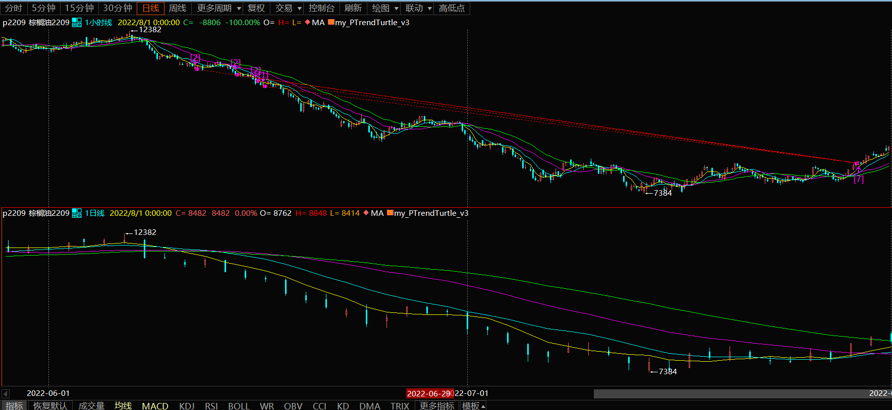
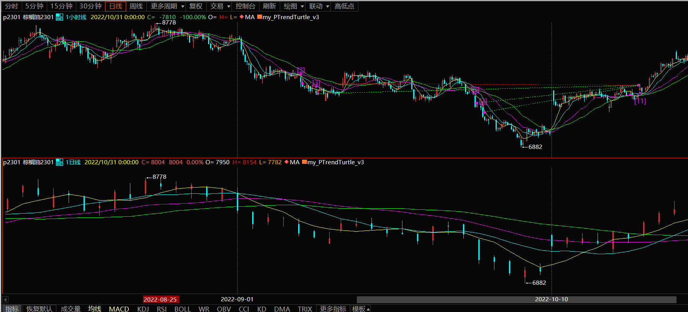
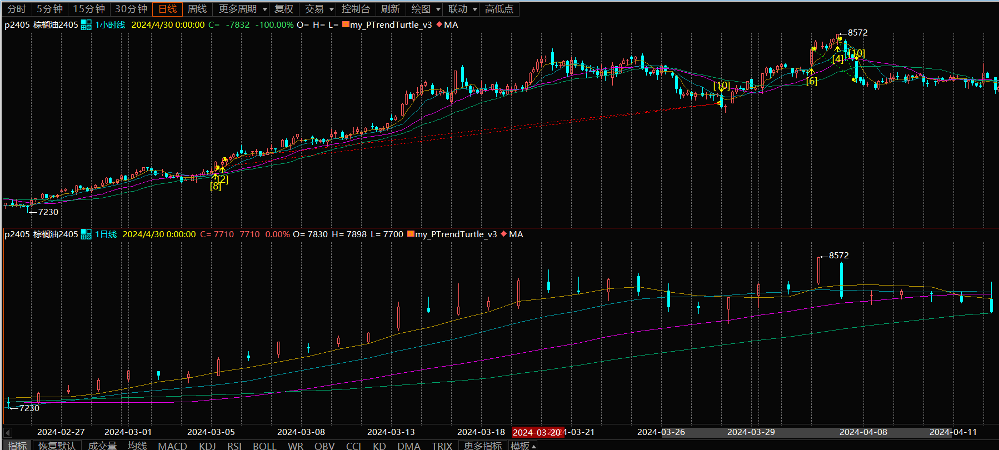
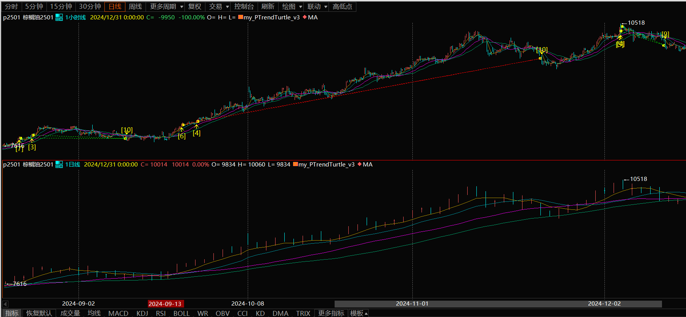
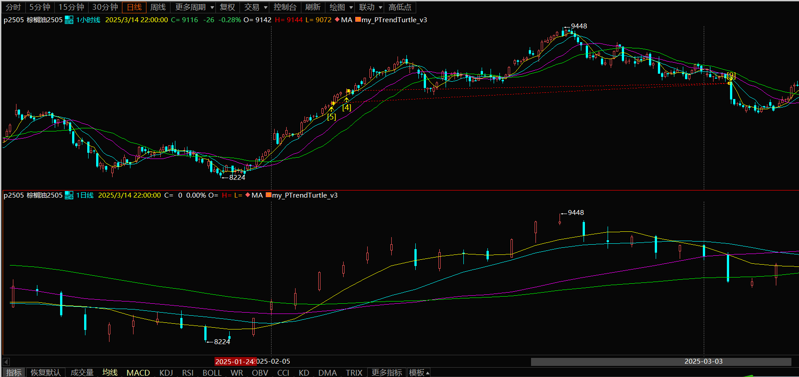

# 棕榈油策略回测结果

## 回测实际交易（05-PTrend-v2.0 当前版）

### 行情1 (2020/03/13 - 2021/01/31) 低 4274（2020/04/27，P2009）→ 高 7356（2021/01/11，P2105）

（注：每行盈亏为该段平仓盈亏，换月平旧行含换月价差；不含手续费）

| 时间 | 合约 | 动作 | 价格 | 原因 | 盈亏 |
|---|---|---|---|---|---|
| 2020-03-25 14:45:00 | P2005.XDCE | 开仓 | 4880.0 | 站上中轨（MA20） |  |
| 2020-03-31 14:45:00 | P2009.XDCE | 换月开新 | 4768.0 | 主力切换（P2005.XDCE→P2009.XDCE） |  |
| 2020-03-31 14:45:00 | P2005.XDCE | 换月平旧 | 4892.0 | 主力切换（P2005.XDCE→P2009.XDCE） | +2,040 |
| 2020-04-16 14:36:00 | P2009.XDCE | 平仓 | 4598.0 | 移动止损（2×ATR 吊灯） | -28,900 |
| 2020-05-15 14:45:00 | P2009.XDCE | 开仓 | 4484.0 | 站上中轨（MA20） |  |
| 2020-06-12 09:01:00 | P2009.XDCE | 平仓 | 4842.0 | 移动止损（2×ATR 吊灯） | +64,440 |
| 2020-06-15 14:45:00 | P2009.XDCE | 开仓 | 4852.0 | 站上中轨（MA20） |  |
| 2020-06-29 09:01:00 | P2009.XDCE | 平仓 | 4998.0 | 移动止损（2×ATR 吊灯） | +24,820 |
| 2020-06-30 14:45:00 | P2009.XDCE | 开仓 | 4994.0 | 站上中轨（MA20） |  |
| 2020-07-28 10:47:00 | P2009.XDCE | 平仓 | 5592.0 | 移动止损（2×ATR 吊灯） | +101,660 |
| 2020-07-29 14:45:00 | P2009.XDCE | 开仓 | 5614.0 | 站上中轨（MA20） |  |
| 2020-08-10 09:04:00 | P2009.XDCE | 平仓 | 5806.0 | 移动止损（2×ATR 吊灯） | +32,640 |
| 2020-08-11 14:45:00 | P2009.XDCE | 开仓 | 5756.0 | 站上中轨（MA20） |  |
| 2020-08-13 14:45:00 | P2101.XDCE | 换月开新 | 5662.0 | 主力切换（P2009.XDCE→P2101.XDCE） |  |
| 2020-08-13 14:45:00 | P2009.XDCE | 换月平旧 | 5844.0 | 主力切换（P2009.XDCE→P2101.XDCE） | +14,960 |
| 2020-08-25 14:01:00 | P2101.XDCE | 平仓 | 5530.0 | 移动止损（2×ATR 吊灯） | -22,440 |
| 2020-08-27 14:45:00 | P2101.XDCE | 开仓 | 5654.0 | 站上中轨（MA20） |  |
| 2020-09-21 22:39:00 | P2101.XDCE | 平仓 | 6226.0 | 移动止损（2×ATR 吊灯） | +97,240 |
| 2020-09-22 14:45:00 | P2101.XDCE | 开仓 | 6180.0 | 站上中轨（MA20） |  |
| 2020-09-24 09:15:00 | P2101.XDCE | 平仓 | 5940.0 | 移动止损（2×ATR 吊灯） | -40,800 |
| 2020-10-09 14:45:00 | P2101.XDCE | 开仓 | 6078.0 | 站上中轨（MA20） |  |
| 2020-10-15 21:22:00 | P2101.XDCE | 平仓 | 5938.0 | 移动止损（2×ATR 吊灯） | -23,800 |
| 2020-10-22 14:45:00 | P2101.XDCE | 开仓 | 6098.0 | 站上中轨（MA20） |  |
| 2020-11-24 09:01:00 | P2101.XDCE | 平仓 | 6612.0 | 移动止损（2×ATR 吊灯） | +82,240 |
| 2020-11-25 14:45:00 | P2101.XDCE | 开仓 | 6716.0 | 站上中轨（MA20） |  |
| 2020-12-01 09:02:00 | P2101.XDCE | 平仓 | 6530.0 | 移动止损（2×ATR 吊灯） | -29,760 |
| 2020-12-04 14:45:00 | P2101.XDCE | 开仓 | 6732.0 | 站上中轨（MA20） |  |
| 2020-12-10 14:45:00 | P2105.XDCE | 换月开新 | 6362.0 | 主力切换（P2101.XDCE→P2105.XDCE） |  |
| 2020-12-10 14:45:00 | P2101.XDCE | 换月平旧 | 6694.0 | 主力切换（P2101.XDCE→P2105.XDCE） | -5,700 |
| 2020-12-22 15:00:00 | P2105.XDCE | 平仓 | 6570.0 | 移动止损（2×ATR 吊灯） | +31,200 |
| 2020-12-23 14:45:00 | P2105.XDCE | 开仓 | 6662.0 | 站上中轨（MA20） |  |
| 2021-01-11 22:31:00 | P2105.XDCE | 平仓 | 7024.0 | 移动止损（2×ATR 吊灯） | +57,920 |
| 2021-01-12 14:45:00 | P2105.XDCE | 开仓 | 7130.0 | 站上中轨（MA20） |  |
| 2021-01-14 14:54:00 | P2105.XDCE | 平仓 | 6794.0 | 移动止损（2×ATR 吊灯） | -50,400 |

合计：**+307,360**（14 笔）

### 行情2 (2021/06/01 - 2022/03/31) 低 6606（2021/06/18，P2109）→ 高 12796（2022/03/03，P2205）

| 时间 | 合约 | 动作 | 价格 | 原因 | 盈亏 |
|---|---|---|---|---|---|
| 2021-06-03 14:45:00 | P2109.XDCE | 开仓 | 8110.0 | 站上中轨（MA20） |  |
| 2021-06-09 21:01:00 | P2109.XDCE | 平仓 | 7580.0 | 移动止损（2×ATR 吊灯） | -53,000 |
| 2021-07-01 14:45:00 | P2109.XDCE | 开仓 | 7484.0 | 站上中轨（MA20） |  |
| 2021-08-02 21:09:00 | P2109.XDCE | 平仓 | 8056.0 | 移动止损（2×ATR 吊灯） | +57,200 |
| 2021-08-03 14:45:00 | P2109.XDCE | 开仓 | 8194.0 | 站上中轨（MA20） |  |
| 2021-08-18 10:46:00 | P2109.XDCE | 平仓 | 8702.0 | 移动止损（2×ATR 吊灯） | +50,800 |
| 2021-08-19 14:45:00 | P2201.XDCE | 开仓 | 8202.0 | 站上中轨（MA20） |  |
| 2021-09-01 21:57:00 | P2201.XDCE | 平仓 | 8008.0 | 移动止损（2×ATR 吊灯） | -19,400 |
| 2021-09-03 14:45:00 | P2201.XDCE | 开仓 | 8334.0 | 站上中轨（MA20） |  |
| 2021-09-17 11:18:00 | P2201.XDCE | 平仓 | 8182.0 | 移动止损（2×ATR 吊灯） | -15,200 |
| 2021-09-22 14:45:00 | P2201.XDCE | 开仓 | 8352.0 | 站上中轨（MA20） |  |
| 2021-10-13 10:31:00 | P2201.XDCE | 平仓 | 9176.0 | 移动止损（2×ATR 吊灯） | +82,400 |
| 2021-10-14 14:45:00 | P2201.XDCE | 开仓 | 9270.0 | 站上中轨（MA20） |  |
| 2021-10-22 09:37:00 | P2201.XDCE | 平仓 | 9510.0 | 移动止损（2×ATR 吊灯） | +21,600 |
| 2021-10-25 14:45:00 | P2201.XDCE | 开仓 | 9586.0 | 站上中轨（MA20） |  |
| 2021-11-05 21:11:00 | P2201.XDCE | 平仓 | 9326.0 | 移动止损（2×ATR 吊灯） | -23,400 |
| 2021-11-17 14:45:00 | P2201.XDCE | 开仓 | 9678.0 | 站上中轨（MA20） |  |
| 2021-11-26 21:01:00 | P2201.XDCE | 平仓 | 9302.0 | 移动止损（2×ATR 吊灯） | -33,840 |
| 2021-12-03 14:45:00 | P2201.XDCE | 开仓 | 9478.0 | 站上中轨（MA20） |  |
| 2021-12-10 14:45:00 | P2205.XDCE | 换月开新 | 8078.0 | 主力切换（P2201.XDCE→P2205.XDCE） |  |
| 2021-12-10 14:45:00 | P2201.XDCE | 换月平旧 | 9194.0 | 主力切换（P2201.XDCE→P2205.XDCE） | -25,560 |
| 2021-12-10 14:46:00 | P2205.XDCE | 平仓 | 8070.0 | 移动止损（2×ATR 吊灯） | -720 |
| 2021-12-23 14:45:00 | P2205.XDCE | 开仓 | 8142.0 | 站上中轨（MA20） |  |
| 2022-02-08 21:01:00 | P2205.XDCE | 平仓 | 9850.0 | 移动止损（2×ATR 吊灯） | +170,800 |
| 2022-02-09 14:45:00 | P2205.XDCE | 开仓 | 9884.0 | 站上中轨（MA20） |  |
| 2022-02-24 22:55:00 | P2205.XDCE | 平仓 | 11380.0 | 移动止损（2×ATR 吊灯） | +149,600 |
| 2022-02-25 14:45:00 | P2205.XDCE | 开仓 | 11204.0 | 站上中轨（MA20） |  |
| 2022-03-04 10:00:00 | P2205.XDCE | 平仓 | 12140.0 | 移动止损（2×ATR 吊灯） | +93,600 |
| 2022-03-07 14:45:00 | P2205.XDCE | 开仓 | 11750.0 | 站上中轨（MA20） |  |
| 2022-03-14 09:14:00 | P2205.XDCE | 平仓 | 11820.0 | 移动止损（2×ATR 吊灯） | +7,000 |

合计：**+461,880**（14 笔）

### 行情3 (2022/05/01 - 2022/10/31) 高 12382（2022/06/08，P2209）→ 低 6882（2022/09/29，P2301）

| 时间 | 合约 | 动作 | 价格 | 原因 | 盈亏 |
|---|---|---|---|---|---|
| 2022-05-17 14:45:00 | P2209.XDCE | 开仓 | 11422.0 | 跌破中轨（MA20） |  |
| 2022-05-26 22:21:00 | P2209.XDCE | 平仓 | 12072.0 | 移动止损（2×ATR 吊灯） | -45,500 |
| 2022-06-09 14:45:00 | P2209.XDCE | 开仓 | 11526.0 | 跌破中轨（MA20） |  |
| 2022-06-28 14:30:00 | P2209.XDCE | 平仓 | 9680.0 | 移动止损（2×ATR 吊灯） | +110,760 |
| 2022-06-29 14:45:00 | P2209.XDCE | 开仓 | 9478.0 | 跌破中轨（MA20） |  |
| 2022-07-18 21:02:00 | P2209.XDCE | 平仓 | 8150.0 | 移动止损（2×ATR 吊灯） | +119,520 |
| 2022-07-19 14:45:00 | P2209.XDCE | 开仓 | 7884.0 | 跌破中轨（MA20） |  |
| 2022-07-29 09:01:00 | P2209.XDCE | 平仓 | 8582.0 | 移动止损（2×ATR 吊灯） | -83,760 |
| 2022-08-04 14:45:00 | P2209.XDCE | 开仓 | 7814.0 | 跌破中轨（MA20） |  |
| 2022-08-11 21:01:00 | P2209.XDCE | 平仓 | 8678.0 | 移动止损（2×ATR 吊灯） | -95,040 |
| 2022-09-01 14:45:00 | P2301.XDCE | 开仓 | 8196.0 | 跌破中轨（MA20） |  |
| 2022-10-10 09:01:00 | P2301.XDCE | 平仓 | 7614.0 | 移动止损（2×ATR 吊灯） | +58,200 |
| 2022-10-13 14:45:00 | P2301.XDCE | 开仓 | 7584.0 | 跌破中轨（MA20） |  |
| 2022-10-18 13:31:00 | P2301.XDCE | 平仓 | 7992.0 | 移动止损（2×ATR 吊灯） | -44,880 |

合计：**+19,300**（7 笔）

### 行情4 (2024/02/01 - 2024/04/26) 低 6990（2024/02/05，P2405）→ 高 8572（2024/04/03，P2405）

| 时间 | 合约 | 动作 | 价格 | 原因 | 盈亏 |
|---|---|---|---|---|---|
| 2024-02-20 14:45:00 | P2405.XDCE | 开仓 | 7322.0 | 站上中轨（MA20） |  |
| 2024-03-25 09:01:00 | P2405.XDCE | 平仓 | 8186.0 | 移动止损（2×ATR 吊灯） | +95,040 |
| 2024-03-26 14:45:00 | P2405.XDCE | 开仓 | 8238.0 | 站上中轨（MA20） |  |
| 2024-03-28 21:18:00 | P2405.XDCE | 平仓 | 8042.0 | 移动止损（2×ATR 吊灯） | -21,560 |
| 2024-03-29 14:45:00 | P2405.XDCE | 开仓 | 8198.0 | 站上中轨（MA20） |  |
| 2024-04-08 13:45:00 | P2405.XDCE | 平仓 | 8248.0 | 移动止损（2×ATR 吊灯） | +5,000 |
| 2024-04-09 14:45:00 | P2405.XDCE | 开仓 | 8228.0 | 站上中轨（MA20） |  |
| 2024-04-11 14:45:00 | P2409.XDCE | 换月开新 | 7900.0 | 主力切换（P2405.XDCE→P2409.XDCE） |  |
| 2024-04-11 14:45:00 | P2405.XDCE | 换月平旧 | 8250.0 | 主力切换（P2405.XDCE→P2409.XDCE） | +2,200 |
| 2024-04-15 14:54:00 | P2409.XDCE | 平仓 | 7662.0 | 移动止损（2×ATR 吊灯） | -23,800 |

合计：**+56,880**（4 笔）

### 行情5 (2024/08/01 - 2024/12/30) 低 7324（2024/08/14，P2501）→ 高 10518（2024/12/04，P2501）

| 时间 | 合约 | 动作 | 价格 | 原因 | 盈亏 |
|---|---|---|---|---|---|
| 2024-08-02 14:45:00 | P2409.XDCE | 开仓 | 7970.0 | 站上中轨（MA20） |  |
| 2024-08-06 11:01:00 | P2409.XDCE | 平仓 | 7614.0 | 移动止损（2×ATR 吊灯） | -35,600 |
| 2024-08-20 14:45:00 | P2501.XDCE | 开仓 | 7636.0 | 站上中轨（MA20） |  |
| 2024-09-04 14:20:00 | P2501.XDCE | 平仓 | 7824.0 | 移动止损（2×ATR 吊灯） | +18,800 |
| 2024-09-05 14:45:00 | P2501.XDCE | 开仓 | 7858.0 | 站上中轨（MA20） |  |
| 2024-10-08 13:31:00 | P2501.XDCE | 平仓 | 8760.0 | 移动止损（2×ATR 吊灯） | +90,200 |
| 2024-10-09 14:45:00 | P2501.XDCE | 开仓 | 8722.0 | 站上中轨（MA20） |  |
| 2024-11-13 09:20:00 | P2501.XDCE | 平仓 | 9990.0 | 移动止损（2×ATR 吊灯） | +126,800 |
| 2024-11-14 14:45:00 | P2501.XDCE | 开仓 | 9922.0 | 站上中轨（MA20） |  |
| 2024-11-18 21:18:00 | P2501.XDCE | 平仓 | 9764.0 | 移动止损（2×ATR 吊灯） | -15,800 |
| 2024-11-19 14:45:00 | P2501.XDCE | 开仓 | 10000.0 | 站上中轨（MA20） |  |
| 2024-11-21 10:54:00 | P2501.XDCE | 平仓 | 9556.0 | 移动止损（2×ATR 吊灯） | -39,960 |
| 2024-11-27 14:45:00 | P2501.XDCE | 开仓 | 9856.0 | 站上中轨（MA20） |  |
| 2024-12-10 14:31:00 | P2501.XDCE | 平仓 | 10016.0 | 移动止损（2×ATR 吊灯） | +14,400 |
| 2024-12-11 14:45:00 | P2505.XDCE | 开仓 | 9332.0 | 站上中轨（MA20） |  |
| 2024-12-18 21:07:00 | P2505.XDCE | 平仓 | 8914.0 | 移动止损（2×ATR 吊灯） | -41,800 |

合计：**+117,040**（8 笔）

### 行情6 (2025/01/01 - 2025/03/10) 低 8224（2025/01/23，P2505）→ 高 9448（2025/02/21，P2505）

| 时间 | 合约 | 动作 | 价格 | 原因 | 盈亏 |
|---|---|---|---|---|---|
| 2025-01-13 14:45:00 | P2505.XDCE | 开仓 | 8762.0 | 站上中轨（MA20） |  |
| 2025-01-16 13:33:00 | P2505.XDCE | 平仓 | 8368.0 | 移动止损（2×ATR 吊灯） | -35,460 |
| 2025-02-05 14:45:00 | P2505.XDCE | 开仓 | 8630.0 | 站上中轨（MA20） |  |
| 2025-02-27 10:33:00 | P2505.XDCE | 平仓 | 9066.0 | 移动止损（2×ATR 吊灯） | +39,240 |
| 2025-02-28 14:45:00 | P2505.XDCE | 开仓 | 9110.0 | 站上中轨（MA20） |  |
| 2025-03-04 10:58:00 | P2505.XDCE | 平仓 | 8820.0 | 移动止损（2×ATR 吊灯） | -26,100 |

合计：**-22,320**（3 笔）

## 回测实际交易（05-PTrend-turtle-v3.1）

### 行情1 (2020/03/13 - 2021/01/31) 低 4274（2020/04/27，P2009）→ 高 7356（2021/01/11，P2105）

（注：每行盈亏为该段平仓盈亏，同分钟多档平仓合并为一行（盈亏与手数为合计）；换月平旧行含换月价差；加仓为每 0.5N 顺向加仓，受当前权益 10% 保证金占用上限约束（按剩余额度开满，档位手数可能递减）；不含手续费）

| 时间 | 合约 | 动作 | 手数 | 价格 | 原因 | 盈亏 |
|---|---|---|---|---|---|---|
| 2020-05-26 22:41:00 | P2009.XDCE | 开仓 | 8 | 4636.0 | 突破前20日高点 |  |
| 2020-05-27 14:48:00 | P2009.XDCE | 加仓 | 8 | 4690.0 | 顺向加仓（第2档，+0.5N） |  |
| 2020-05-28 09:06:00 | P2009.XDCE | 加仓 | 1 | 4748.0 | 顺向加仓（第3档，+0.5N） |  |
| 2020-08-13 14:45:00 | P2101.XDCE | 换月开新 | 17 | 5662.0 | 主力切换（P2009.XDCE→P2101.XDCE） |  |
| 2020-08-13 14:45:00 | P2009.XDCE | 换月平旧 | 17 | 5844.0 | 主力切换（P2009.XDCE→P2101.XDCE） | +199,920 |
| 2020-09-29 21:16:00 | P2101.XDCE | 平仓 | 17 | 5808.0 | 反向突破（前10日极值） | +24,820 |
| 2020-10-30 09:02:00 | P2101.XDCE | 开仓 | 6 | 6356.0 | 突破前20日高点 |  |
| 2020-10-30 10:32:00 | P2101.XDCE | 加仓 | 6 | 6444.0 | 顺向加仓（第2档，+0.5N） |  |
| 2020-11-05 13:35:00 | P2101.XDCE | 加仓 | 3 | 6538.0 | 顺向加仓（第3档，+0.5N） |  |
| 2020-12-01 09:01:00 | P2101.XDCE | 平仓 | 15 | 6524.0 | 反向突破（前10日极值） | +14,460 |
| 2020-12-11 14:16:00 | P2105.XDCE | 开仓 | 8 | 6628.0 | 突破前20日高点 |  |
| 2020-12-16 11:17:00 | P2105.XDCE | 加仓 | 7 | 6702.0 | 顺向加仓（第2档，+0.5N） |  |
| 2021-01-14 14:52:00 | P2105.XDCE | 平仓 | 15 | 6796.0 | 反向突破（前10日极值） | +20,020 |

合计：**+259,220**（3 笔）

### 行情2 (2021/06/01 - 2022/03/31) 低 6606（2021/06/18，P2109）→ 高 12796（2022/03/03，P2205）

| 时间 | 合约 | 动作 | 手数 | 价格 | 原因 | 盈亏 |
|---|---|---|---|---|---|---|
| 2021-07-09 14:35:00 | P2109.XDCE | 开仓 | 4 | 7794.0 | 突破前20日高点 |  |
| 2021-07-12 09:01:00 | P2109.XDCE | 加仓 | 4 | 7928.0 | 顺向加仓（第2档，+0.5N） |  |
| 2021-07-15 21:01:00 | P2109.XDCE | 加仓 | 2 | 8052.0 | 顺向加仓（第3档，+0.5N） |  |
| 2021-08-18 14:45:00 | P2201.XDCE | 换月开新 | 10 | 8126.0 | 主力切换（P2109.XDCE→P2201.XDCE） |  |
| 2021-08-18 14:45:00 | P2109.XDCE | 换月平旧 | 10 | 8712.0 | 主力切换（P2109.XDCE→P2201.XDCE） | +81,280 |
| 2021-08-19 10:53:00 | P2201.XDCE | 加仓 | 1 | 8238.0 | 顺向加仓（第4档，+0.5N） |  |
| 2021-09-22 09:01:00 | P2201.XDCE | 平仓 | 11 | 8196.0 | 反向突破（前10日极值） | +6,580 |
| 2021-09-23 14:55:00 | P2201.XDCE | 开仓 | 4 | 8662.0 | 突破前20日高点 |  |
| 2021-09-29 22:47:00 | P2201.XDCE | 加仓 | 4 | 8798.0 | 顺向加仓（第2档，+0.5N） |  |
| 2021-10-08 09:01:00 | P2201.XDCE | 加仓 | 2 | 9312.0 | 顺向加仓（第3档，+0.5N） |  |
| 2021-11-05 21:19:00 | P2201.XDCE | 平仓 | 10 | 9230.0 | 反向突破（前10日极值） | +38,360 |
| 2021-11-19 14:44:00 | P2201.XDCE | 开仓 | 3 | 9966.0 | 突破前20日高点 |  |
| 2021-11-26 21:01:00 | P2201.XDCE | 平仓 | 3 | 9302.0 | 止损（2N） | -19,920 |
| 2021-12-28 13:52:00 | P2205.XDCE | 开仓 | 4 | 8488.0 | 突破前20日高点 |  |
| 2022-01-04 09:01:00 | P2205.XDCE | 加仓 | 4 | 8654.0 | 顺向加仓（第2档，+0.5N） |  |
| 2022-01-04 22:50:00 | P2205.XDCE | 加仓 | 2 | 8774.0 | 顺向加仓（第3档，+0.5N） |  |
| 2022-03-15 09:01:00 | P2205.XDCE | 平仓 | 10 | 11268.0 | 反向突破（前10日极值） | +265,640 |

合计：**+371,940**（4 笔）

### 行情3 (2022/05/01 - 2022/10/31) 高 12382（2022/06/08，P2209）→ 低 6882（2022/09/29，P2301）

| 时间 | 合约 | 动作 | 手数 | 价格 | 原因 | 盈亏 |
|---|---|---|---|---|---|---|
| 2022-06-13 13:32:00 | P2209.XDCE | 开仓 | 2 | 11250.0 | 突破前20日低点 |  |
| 2022-06-15 13:33:00 | P2209.XDCE | 加仓 | 2 | 11072.0 | 顺向加仓（第2档，+0.5N） |  |
| 2022-06-16 11:27:00 | P2209.XDCE | 加仓 | 2 | 10908.0 | 顺向加仓（第3档，+0.5N） |  |
| 2022-06-16 21:06:00 | P2209.XDCE | 加仓 | 1 | 10748.0 | 顺向加仓（第4档，+0.5N） |  |
| 2022-07-28 11:12:00 | P2209.XDCE | 平仓 | 7 | 8324.0 | 反向突破（前10日极值） | +189,400 |
| 2022-09-07 09:02:00 | P2301.XDCE | 开仓 | 3 | 7850.0 | 突破前20日低点 |  |
| 2022-09-08 09:56:00 | P2301.XDCE | 加仓 | 3 | 7700.0 | 顺向加仓（第2档，+0.5N） |  |
| 2022-09-23 21:03:00 | P2301.XDCE | 加仓 | 4 | 7550.0 | 顺向加仓（第3档，+0.5N） |  |
| 2022-09-26 10:48:00 | P2301.XDCE | 加仓 | 3 | 7404.0 | 顺向加仓（第4档，+0.5N） |  |
| 2022-10-17 21:03:00 | P2301.XDCE | 平仓 | 13 | 7822.0 | 反向突破（前10日极值） | -26,240 |

合计：**+163,160**（2 笔）

### 行情4 (2024/02/01 - 2024/04/26) 低 6990（2024/02/05，P2405）→ 高 8572（2024/04/03，P2405）

| 时间 | 合约 | 动作 | 手数 | 价格 | 原因 | 盈亏 |
|---|---|---|---|---|---|---|
| 2024-03-05 22:39:00 | P2405.XDCE | 开仓 | 8 | 7578.0 | 突破前20日高点 |  |
| 2024-03-06 10:39:00 | P2405.XDCE | 加仓 | 2 | 7638.0 | 顺向加仓（第2档，+0.5N） |  |
| 2024-03-29 09:01:00 | P2405.XDCE | 平仓 | 10 | 8074.0 | 反向突破（前10日极值） | +48,400 |
| 2024-04-02 21:43:00 | P2405.XDCE | 开仓 | 6 | 8464.0 | 突破前20日高点 |  |
| 2024-04-03 14:43:00 | P2405.XDCE | 加仓 | 4 | 8538.0 | 顺向加仓（第2档，+0.5N） |  |
| 2024-04-08 13:52:00 | P2405.XDCE | 平仓 | 10 | 8216.0 | 止损（2N） | -27,760 |

合计：**+20,640**（2 笔）

### 行情5 (2024/08/01 - 2024/12/30) 低 7324（2024/08/14，P2501）→ 高 10518（2024/12/04，P2501）

| 时间 | 合约 | 动作 | 手数 | 价格 | 原因 | 盈亏 |
|---|---|---|---|---|---|---|
| 2024-08-22 13:31:00 | P2501.XDCE | 开仓 | 7 | 7820.0 | 突破前20日高点 |  |
| 2024-08-23 22:37:00 | P2501.XDCE | 加仓 | 3 | 7892.0 | 顺向加仓（第2档，+0.5N） |  |
| 2024-09-09 10:50:00 | P2501.XDCE | 平仓 | 10 | 7786.0 | 反向突破（前10日极值） | -5,560 |
| 2024-09-19 13:46:00 | P2501.XDCE | 开仓 | 6 | 8132.0 | 突破前20日高点 |  |
| 2024-09-23 09:01:00 | P2501.XDCE | 加仓 | 4 | 8196.0 | 顺向加仓（第2档，+0.5N） |  |
| 2024-11-21 09:03:00 | P2501.XDCE | 平仓 | 10 | 9700.0 | 反向突破（前10日极值） | +154,240 |
| 2024-12-03 14:28:00 | P2501.XDCE | 开仓 | 5 | 10330.0 | 突破前20日高点 |  |
| 2024-12-03 21:01:00 | P2501.XDCE | 加仓 | 4 | 10486.0 | 顺向加仓（第2档，+0.5N） |  |
| 2024-12-10 14:17:00 | P2501.XDCE | 平仓 | 9 | 10040.0 | 止损（2N） | -32,340 |

合计：**+116,340**（3 笔）

### 行情6 (2025/01/01 - 2025/03/10) 低 8224（2025/01/23，P2505）→ 高 9448（2025/02/21，P2505）

| 时间 | 合约 | 动作 | 手数 | 价格 | 原因 | 盈亏 |
|---|---|---|---|---|---|---|
| 2025-02-07 13:31:00 | P2505.XDCE | 开仓 | 5 | 8830.0 | 突破前20日高点 |  |
| 2025-02-10 09:01:00 | P2505.XDCE | 加仓 | 4 | 8948.0 | 顺向加仓（第2档，+0.5N） |  |
| 2025-03-04 09:01:00 | P2505.XDCE | 平仓 | 9 | 8974.0 | 反向突破（前10日极值） | +8,240 |

合计：**+8,240**（1 笔）

## 回测实际交易（05-PTrend-turtle-v3.2，stall_period=10）

（新增并行入场条件：日线连续 10 日极值停滞（未创新低/多头；未创新高/空头）即入场，与原有“突破前 20 日高点/低点”谁先触发谁入场；STALL 触发时刻为日线 key 更新后的首个分钟，持仓中达到计数则跳过。其余规则及表格口径与 v3.1 节相同）

| 切片 | v3.1 基线 | v3.2（stall=10） | 差值 | STALL 触发 |
|---|---|---|---|---|
| 行情1 | +259,220 | +315,600 | +56,380 | 3 |
| 行情2 | +371,940 | +373,360 | +1,420 | 2 |
| 行情3 | +163,160 | +154,400 | -8,760 | 1 |
| 行情4 | +20,640 | +44,760 | +24,120 | 1 |
| 行情5 | +116,340 | +116,340 | +0 | 0 |
| 行情6 | +8,240 | +8,240 | +0 | 0 |
| 合计 | +939,540 | +1,012,700 | +73,160 | 7 |

### 行情1 (2020/03/13 - 2021/01/31) 低 4274（2020/04/27，P2009）→ 高 7356（2021/01/11，P2105）

| 时间 | 合约 | 动作 | 手数 | 价格 | 原因 | 盈亏 |
|---|---|---|---|---|---|---|
| 2020-03-30 09:01:00 | P2005.XDCE | 开仓 | 6 | 4846.0 | 停滞入场（并行条件） |  |
| 2020-03-30 09:14:00 | P2005.XDCE | 加仓 | 6 | 4924.0 | 顺向加仓（第2档，+0.5N） |  |
| 2020-03-30 14:56:00 | P2005.XDCE | 加仓 | 4 | 5006.0 | 顺向加仓（第3档，+0.5N） |  |
| 2020-03-31 14:45:00 | P2009.XDCE | 换月开新 | 16 | 4768.0 | 主力切换（P2005.XDCE→P2009.XDCE） |  |
| 2020-03-31 14:45:00 | P2005.XDCE | 换月平旧 | 16 | 4892.0 | 主力切换（P2005.XDCE→P2009.XDCE） | -3,720 |
| 2020-04-08 09:46:00 | P2009.XDCE | 加仓 | 1 | 4842.0 | 顺向加仓（第4档，+0.5N） |  |
| 2020-04-16 14:24:00 | P2009.XDCE | 平仓 | 17 | 4624.0 | 反向突破（前10日极值） | -25,220 |
| 2020-05-15 09:01:00 | P2009.XDCE | 开仓 | 8 | 4438.0 | 停滞入场（并行条件） |  |
| 2020-05-15 14:58:00 | P2009.XDCE | 加仓 | 8 | 4496.0 | 顺向加仓（第2档，+0.5N） |  |
| 2020-05-18 09:24:00 | P2009.XDCE | 加仓 | 2 | 4550.0 | 顺向加仓（第3档，+0.5N） |  |
| 2020-08-13 14:45:00 | P2101.XDCE | 换月开新 | 18 | 5662.0 | 主力切换（P2009.XDCE→P2101.XDCE） |  |
| 2020-08-13 14:45:00 | P2009.XDCE | 换月平旧 | 18 | 5844.0 | 主力切换（P2009.XDCE→P2101.XDCE） | +246,200 |
| 2020-09-29 21:16:00 | P2101.XDCE | 平仓 | 18 | 5808.0 | 反向突破（前10日极值） | +26,280 |
| 2020-10-23 09:01:00 | P2101.XDCE | 开仓 | 6 | 6144.0 | 停滞入场（并行条件） |  |
| 2020-10-26 09:06:00 | P2101.XDCE | 加仓 | 7 | 6214.0 | 顺向加仓（第2档，+0.5N） |  |
| 2020-10-26 21:01:00 | P2101.XDCE | 加仓 | 3 | 6304.0 | 顺向加仓（第3档，+0.5N） |  |
| 2020-12-01 09:01:00 | P2101.XDCE | 平仓 | 16 | 6524.0 | 反向突破（前10日极值） | +51,100 |
| 2020-12-11 14:16:00 | P2105.XDCE | 开仓 | 8 | 6628.0 | 突破前20日高点 |  |
| 2020-12-16 11:17:00 | P2105.XDCE | 加仓 | 8 | 6702.0 | 顺向加仓（第2档，+0.5N） |  |
| 2021-01-14 14:52:00 | P2105.XDCE | 平仓 | 16 | 6796.0 | 反向突破（前10日极值） | +20,960 |

合计：**+315,600**（4 笔）

### 行情2 (2021/06/01 - 2022/03/31) 低 6606（2021/06/18，P2109）→ 高 12796（2022/03/03，P2205）

| 时间 | 合约 | 动作 | 手数 | 价格 | 原因 | 盈亏 |
|---|---|---|---|---|---|---|
| 2021-06-08 09:01:00 | P2109.XDCE | 开仓 | 3 | 7808.0 | 停滞入场（并行条件） |  |
| 2021-06-11 09:56:00 | P2109.XDCE | 平仓 | 3 | 7478.0 | 反向突破（前10日极值） | -9,900 |
| 2021-07-05 09:01:00 | P2109.XDCE | 开仓 | 3 | 7654.0 | 停滞入场（并行条件） |  |
| 2021-07-06 14:38:00 | P2109.XDCE | 加仓 | 3 | 7774.0 | 顺向加仓（第2档，+0.5N） |  |
| 2021-07-09 22:55:00 | P2109.XDCE | 加仓 | 4 | 7894.0 | 顺向加仓（第3档，+0.5N） |  |
| 2021-08-18 14:45:00 | P2201.XDCE | 换月开新 | 10 | 8126.0 | 主力切换（P2109.XDCE→P2201.XDCE） |  |
| 2021-08-18 14:45:00 | P2109.XDCE | 换月平旧 | 10 | 8712.0 | 主力切换（P2109.XDCE→P2201.XDCE） | +92,600 |
| 2021-08-19 10:53:00 | P2201.XDCE | 加仓 | 1 | 8238.0 | 顺向加仓（第4档，+0.5N） |  |
| 2021-09-22 09:01:00 | P2201.XDCE | 平仓 | 11 | 8196.0 | 反向突破（前10日极值） | +6,580 |
| 2021-09-23 14:55:00 | P2201.XDCE | 开仓 | 4 | 8662.0 | 突破前20日高点 |  |
| 2021-09-29 22:47:00 | P2201.XDCE | 加仓 | 4 | 8798.0 | 顺向加仓（第2档，+0.5N） |  |
| 2021-10-08 09:01:00 | P2201.XDCE | 加仓 | 2 | 9312.0 | 顺向加仓（第3档，+0.5N） |  |
| 2021-11-05 21:19:00 | P2201.XDCE | 平仓 | 10 | 9230.0 | 反向突破（前10日极值） | +38,360 |
| 2021-11-19 14:44:00 | P2201.XDCE | 开仓 | 3 | 9966.0 | 突破前20日高点 |  |
| 2021-11-26 21:01:00 | P2201.XDCE | 平仓 | 3 | 9302.0 | 止损（2N） | -19,920 |
| 2021-12-28 13:52:00 | P2205.XDCE | 开仓 | 4 | 8488.0 | 突破前20日高点 |  |
| 2022-01-04 09:01:00 | P2205.XDCE | 加仓 | 4 | 8654.0 | 顺向加仓（第2档，+0.5N） |  |
| 2022-01-04 22:50:00 | P2205.XDCE | 加仓 | 2 | 8774.0 | 顺向加仓（第3档，+0.5N） |  |
| 2022-03-15 09:01:00 | P2205.XDCE | 平仓 | 10 | 11268.0 | 反向突破（前10日极值） | +265,640 |

合计：**+373,360**（5 笔）

### 行情3 (2022/05/01 - 2022/10/31) 高 12382（2022/06/08，P2209）→ 低 6882（2022/09/29，P2301）

| 时间 | 合约 | 动作 | 手数 | 价格 | 原因 | 盈亏 |
|---|---|---|---|---|---|---|
| 2022-05-19 09:01:00 | P2209.XDCE | 开仓 | 2 | 11364.0 | 未创新高入场（并行条件） |  |
| 2022-05-24 09:19:00 | P2209.XDCE | 平仓 | 2 | 11802.0 | 反向突破（前10日极值） | -8,760 |
| 2022-06-13 13:32:00 | P2209.XDCE | 开仓 | 2 | 11250.0 | 突破前20日低点 |  |
| 2022-06-15 13:33:00 | P2209.XDCE | 加仓 | 2 | 11072.0 | 顺向加仓（第2档，+0.5N） |  |
| 2022-06-16 11:27:00 | P2209.XDCE | 加仓 | 2 | 10908.0 | 顺向加仓（第3档，+0.5N） |  |
| 2022-06-16 21:06:00 | P2209.XDCE | 加仓 | 1 | 10748.0 | 顺向加仓（第4档，+0.5N） |  |
| 2022-07-28 11:12:00 | P2209.XDCE | 平仓 | 7 | 8324.0 | 反向突破（前10日极值） | +189,400 |
| 2022-09-07 09:02:00 | P2301.XDCE | 开仓 | 3 | 7850.0 | 突破前20日低点 |  |
| 2022-09-08 09:56:00 | P2301.XDCE | 加仓 | 3 | 7700.0 | 顺向加仓（第2档，+0.5N） |  |
| 2022-09-23 21:03:00 | P2301.XDCE | 加仓 | 4 | 7550.0 | 顺向加仓（第3档，+0.5N） |  |
| 2022-09-26 10:48:00 | P2301.XDCE | 加仓 | 3 | 7404.0 | 顺向加仓（第4档，+0.5N） |  |
| 2022-10-17 21:03:00 | P2301.XDCE | 平仓 | 13 | 7822.0 | 反向突破（前10日极值） | -26,240 |

合计：**+154,400**（3 笔）

### 行情4 (2024/02/01 - 2024/04/26) 低 6990（2024/02/05，P2405）→ 高 8572（2024/04/03，P2405）

| 时间 | 合约 | 动作 | 手数 | 价格 | 原因 | 盈亏 |
|---|---|---|---|---|---|---|
| 2024-02-28 09:01:00 | P2405.XDCE | 开仓 | 7 | 7390.0 | 停滞入场（并行条件） |  |
| 2024-02-29 09:41:00 | P2405.XDCE | 加仓 | 4 | 7458.0 | 顺向加仓（第2档，+0.5N） |  |
| 2024-03-29 09:01:00 | P2405.XDCE | 平仓 | 11 | 8074.0 | 反向突破（前10日极值） | +72,520 |
| 2024-04-02 21:43:00 | P2405.XDCE | 开仓 | 6 | 8464.0 | 突破前20日高点 |  |
| 2024-04-03 14:43:00 | P2405.XDCE | 加仓 | 4 | 8538.0 | 顺向加仓（第2档，+0.5N） |  |
| 2024-04-08 13:52:00 | P2405.XDCE | 平仓 | 10 | 8216.0 | 止损（2N） | -27,760 |

合计：**+44,760**（2 笔）

### 行情5 (2024/08/01 - 2024/12/30) 低 7324（2024/08/14，P2501）→ 高 10518（2024/12/04，P2501）

| 时间 | 合约 | 动作 | 手数 | 价格 | 原因 | 盈亏 |
|---|---|---|---|---|---|---|
| 2024-08-22 13:31:00 | P2501.XDCE | 开仓 | 7 | 7820.0 | 突破前20日高点 |  |
| 2024-08-23 22:37:00 | P2501.XDCE | 加仓 | 3 | 7892.0 | 顺向加仓（第2档，+0.5N） |  |
| 2024-09-09 10:50:00 | P2501.XDCE | 平仓 | 10 | 7786.0 | 反向突破（前10日极值） | -5,560 |
| 2024-09-19 13:46:00 | P2501.XDCE | 开仓 | 6 | 8132.0 | 突破前20日高点 |  |
| 2024-09-23 09:01:00 | P2501.XDCE | 加仓 | 4 | 8196.0 | 顺向加仓（第2档，+0.5N） |  |
| 2024-11-21 09:03:00 | P2501.XDCE | 平仓 | 10 | 9700.0 | 反向突破（前10日极值） | +154,240 |
| 2024-12-03 14:28:00 | P2501.XDCE | 开仓 | 5 | 10330.0 | 突破前20日高点 |  |
| 2024-12-03 21:01:00 | P2501.XDCE | 加仓 | 4 | 10486.0 | 顺向加仓（第2档，+0.5N） |  |
| 2024-12-10 14:17:00 | P2501.XDCE | 平仓 | 9 | 10040.0 | 止损（2N） | -32,340 |

合计：**+116,340**（3 笔）

### 行情6 (2025/01/01 - 2025/03/10) 低 8224（2025/01/23，P2505）→ 高 9448（2025/02/21，P2505）

| 时间 | 合约 | 动作 | 手数 | 价格 | 原因 | 盈亏 |
|---|---|---|---|---|---|---|
| 2025-02-07 13:31:00 | P2505.XDCE | 开仓 | 5 | 8830.0 | 突破前20日高点 |  |
| 2025-02-10 09:01:00 | P2505.XDCE | 加仓 | 4 | 8948.0 | 顺向加仓（第2档，+0.5N） |  |
| 2025-03-04 09:01:00 | P2505.XDCE | 平仓 | 9 | 8974.0 | 反向突破（前10日极值） | +8,240 |

合计：**+8,240**（1 笔）
