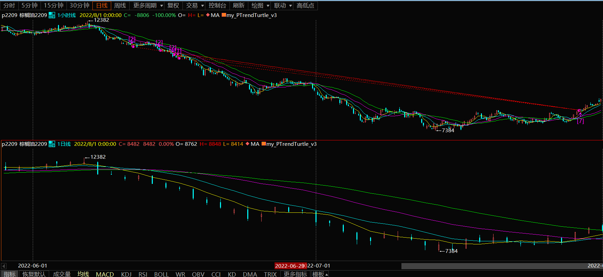
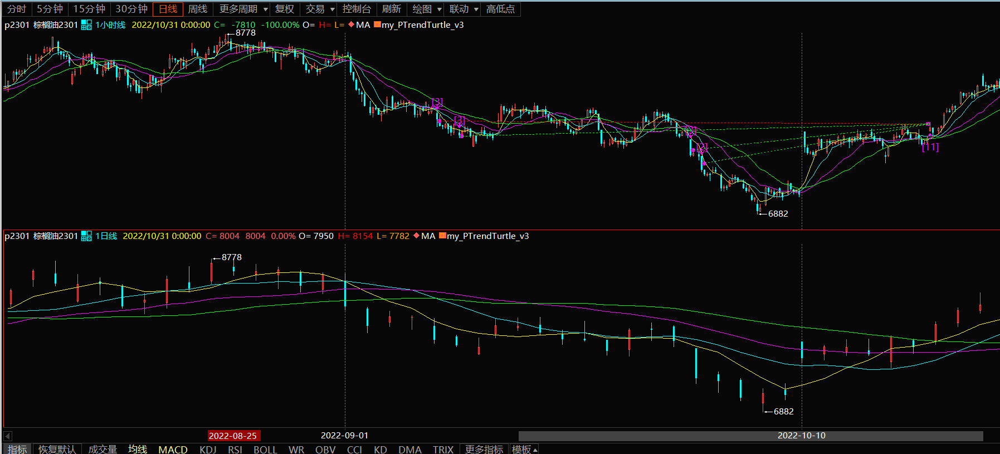
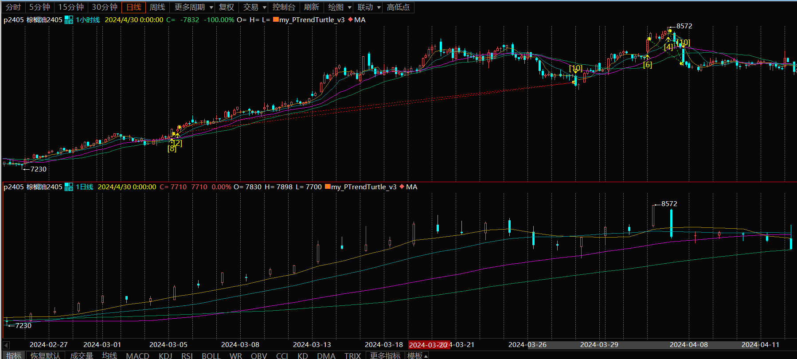
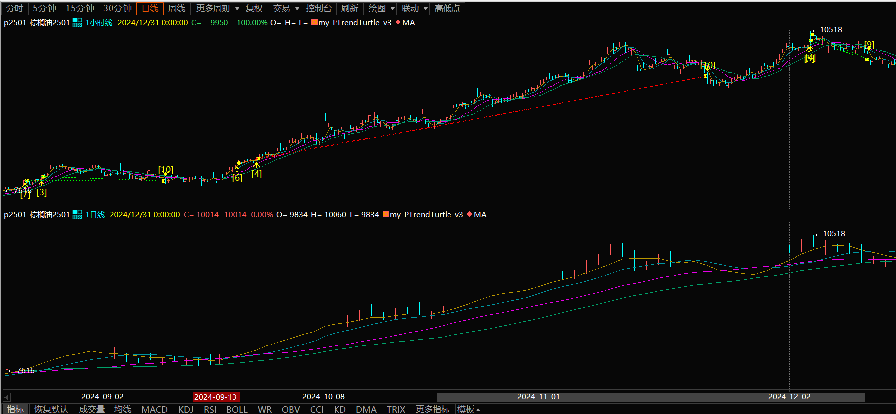
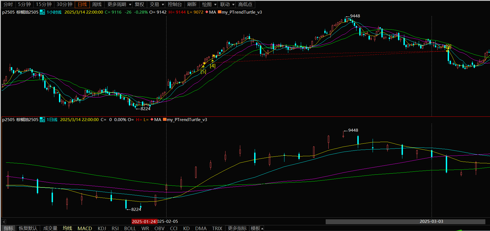

# 棕榈油策略回测结果

## 回测实际交易（05-PTrend-v2.0 当前版）

### 行情1 (2020/03/13 - 2021/01/31) 低 4274（2020/04/27，P2009）→ 高 7356（2021/01/11，P2105）

（注：每行盈亏为该段平仓盈亏，换月平旧行含换月价差；不含手续费）

| 时间 | 合约 | 动作 | 价格 | 原因 | 盈亏 |
|---|---|---|---|---|---|
| 2020-03-25 14:45:00 | P2005.XDCE | 开仓 | 4880.0 | 站上中轨（MA20） |  |
| 2020-03-31 14:45:00 | P2009.XDCE | 换月开新 | 4768.0 | 主力切换（P2005.XDCE→P2009.XDCE） |  |
| 2020-03-31 14:45:00 | P2005.XDCE | 换月平旧 | 4892.0 | 主力切换（P2005.XDCE→P2009.XDCE） | +2,040 |
| 2020-04-16 14:36:00 | P2009.XDCE | 平仓 | 4598.0 | 移动止损（2×ATR 吊灯） | -28,900 |
| 2020-05-15 14:45:00 | P2009.XDCE | 开仓 | 4484.0 | 站上中轨（MA20） |  |
| 2020-06-12 09:01:00 | P2009.XDCE | 平仓 | 4842.0 | 移动止损（2×ATR 吊灯） | +64,440 |
| 2020-06-15 14:45:00 | P2009.XDCE | 开仓 | 4852.0 | 站上中轨（MA20） |  |
| 2020-06-29 09:01:00 | P2009.XDCE | 平仓 | 4998.0 | 移动止损（2×ATR 吊灯） | +24,820 |
| 2020-06-30 14:45:00 | P2009.XDCE | 开仓 | 4994.0 | 站上中轨（MA20） |  |
| 2020-07-28 10:47:00 | P2009.XDCE | 平仓 | 5592.0 | 移动止损（2×ATR 吊灯） | +101,660 |
| 2020-07-29 14:45:00 | P2009.XDCE | 开仓 | 5614.0 | 站上中轨（MA20） |  |
| 2020-08-10 09:04:00 | P2009.XDCE | 平仓 | 5806.0 | 移动止损（2×ATR 吊灯） | +32,640 |
| 2020-08-11 14:45:00 | P2009.XDCE | 开仓 | 5756.0 | 站上中轨（MA20） |  |
| 2020-08-13 14:45:00 | P2101.XDCE | 换月开新 | 5662.0 | 主力切换（P2009.XDCE→P2101.XDCE） |  |
| 2020-08-13 14:45:00 | P2009.XDCE | 换月平旧 | 5844.0 | 主力切换（P2009.XDCE→P2101.XDCE） | +14,960 |
| 2020-08-25 14:01:00 | P2101.XDCE | 平仓 | 5530.0 | 移动止损（2×ATR 吊灯） | -22,440 |
| 2020-08-27 14:45:00 | P2101.XDCE | 开仓 | 5654.0 | 站上中轨（MA20） |  |
| 2020-09-21 22:39:00 | P2101.XDCE | 平仓 | 6226.0 | 移动止损（2×ATR 吊灯） | +97,240 |
| 2020-09-22 14:45:00 | P2101.XDCE | 开仓 | 6180.0 | 站上中轨（MA20） |  |
| 2020-09-24 09:15:00 | P2101.XDCE | 平仓 | 5940.0 | 移动止损（2×ATR 吊灯） | -40,800 |
| 2020-10-09 14:45:00 | P2101.XDCE | 开仓 | 6078.0 | 站上中轨（MA20） |  |
| 2020-10-15 21:22:00 | P2101.XDCE | 平仓 | 5938.0 | 移动止损（2×ATR 吊灯） | -23,800 |
| 2020-10-22 14:45:00 | P2101.XDCE | 开仓 | 6098.0 | 站上中轨（MA20） |  |
| 2020-11-24 09:01:00 | P2101.XDCE | 平仓 | 6612.0 | 移动止损（2×ATR 吊灯） | +82,240 |
| 2020-11-25 14:45:00 | P2101.XDCE | 开仓 | 6716.0 | 站上中轨（MA20） |  |
| 2020-12-01 09:02:00 | P2101.XDCE | 平仓 | 6530.0 | 移动止损（2×ATR 吊灯） | -29,760 |
| 2020-12-04 14:45:00 | P2101.XDCE | 开仓 | 6732.0 | 站上中轨（MA20） |  |
| 2020-12-10 14:45:00 | P2105.XDCE | 换月开新 | 6362.0 | 主力切换（P2101.XDCE→P2105.XDCE） |  |
| 2020-12-10 14:45:00 | P2101.XDCE | 换月平旧 | 6694.0 | 主力切换（P2101.XDCE→P2105.XDCE） | -5,700 |
| 2020-12-22 15:00:00 | P2105.XDCE | 平仓 | 6570.0 | 移动止损（2×ATR 吊灯） | +31,200 |
| 2020-12-23 14:45:00 | P2105.XDCE | 开仓 | 6662.0 | 站上中轨（MA20） |  |
| 2021-01-11 22:31:00 | P2105.XDCE | 平仓 | 7024.0 | 移动止损（2×ATR 吊灯） | +57,920 |
| 2021-01-12 14:45:00 | P2105.XDCE | 开仓 | 7130.0 | 站上中轨（MA20） |  |
| 2021-01-14 14:54:00 | P2105.XDCE | 平仓 | 6794.0 | 移动止损（2×ATR 吊灯） | -50,400 |

合计：**+307,360**（14 笔）

### 行情2 (2021/06/01 - 2022/03/31) 低 6606（2021/06/18，P2109）→ 高 12796（2022/03/03，P2205）

| 时间 | 合约 | 动作 | 价格 | 原因 | 盈亏 |
|---|---|---|---|---|---|
| 2021-06-03 14:45:00 | P2109.XDCE | 开仓 | 8110.0 | 站上中轨（MA20） |  |
| 2021-06-09 21:01:00 | P2109.XDCE | 平仓 | 7580.0 | 移动止损（2×ATR 吊灯） | -53,000 |
| 2021-07-01 14:45:00 | P2109.XDCE | 开仓 | 7484.0 | 站上中轨（MA20） |  |
| 2021-08-02 21:09:00 | P2109.XDCE | 平仓 | 8056.0 | 移动止损（2×ATR 吊灯） | +57,200 |
| 2021-08-03 14:45:00 | P2109.XDCE | 开仓 | 8194.0 | 站上中轨（MA20） |  |
| 2021-08-18 10:46:00 | P2109.XDCE | 平仓 | 8702.0 | 移动止损（2×ATR 吊灯） | +50,800 |
| 2021-08-19 14:45:00 | P2201.XDCE | 开仓 | 8202.0 | 站上中轨（MA20） |  |
| 2021-09-01 21:57:00 | P2201.XDCE | 平仓 | 8008.0 | 移动止损（2×ATR 吊灯） | -19,400 |
| 2021-09-03 14:45:00 | P2201.XDCE | 开仓 | 8334.0 | 站上中轨（MA20） |  |
| 2021-09-17 11:18:00 | P2201.XDCE | 平仓 | 8182.0 | 移动止损（2×ATR 吊灯） | -15,200 |
| 2021-09-22 14:45:00 | P2201.XDCE | 开仓 | 8352.0 | 站上中轨（MA20） |  |
| 2021-10-13 10:31:00 | P2201.XDCE | 平仓 | 9176.0 | 移动止损（2×ATR 吊灯） | +82,400 |
| 2021-10-14 14:45:00 | P2201.XDCE | 开仓 | 9270.0 | 站上中轨（MA20） |  |
| 2021-10-22 09:37:00 | P2201.XDCE | 平仓 | 9510.0 | 移动止损（2×ATR 吊灯） | +21,600 |
| 2021-10-25 14:45:00 | P2201.XDCE | 开仓 | 9586.0 | 站上中轨（MA20） |  |
| 2021-11-05 21:11:00 | P2201.XDCE | 平仓 | 9326.0 | 移动止损（2×ATR 吊灯） | -23,400 |
| 2021-11-17 14:45:00 | P2201.XDCE | 开仓 | 9678.0 | 站上中轨（MA20） |  |
| 2021-11-26 21:01:00 | P2201.XDCE | 平仓 | 9302.0 | 移动止损（2×ATR 吊灯） | -33,840 |
| 2021-12-03 14:45:00 | P2201.XDCE | 开仓 | 9478.0 | 站上中轨（MA20） |  |
| 2021-12-10 14:45:00 | P2205.XDCE | 换月开新 | 8078.0 | 主力切换（P2201.XDCE→P2205.XDCE） |  |
| 2021-12-10 14:45:00 | P2201.XDCE | 换月平旧 | 9194.0 | 主力切换（P2201.XDCE→P2205.XDCE） | -25,560 |
| 2021-12-10 14:46:00 | P2205.XDCE | 平仓 | 8070.0 | 移动止损（2×ATR 吊灯） | -720 |
| 2021-12-23 14:45:00 | P2205.XDCE | 开仓 | 8142.0 | 站上中轨（MA20） |  |
| 2022-02-08 21:01:00 | P2205.XDCE | 平仓 | 9850.0 | 移动止损（2×ATR 吊灯） | +170,800 |
| 2022-02-09 14:45:00 | P2205.XDCE | 开仓 | 9884.0 | 站上中轨（MA20） |  |
| 2022-02-24 22:55:00 | P2205.XDCE | 平仓 | 11380.0 | 移动止损（2×ATR 吊灯） | +149,600 |
| 2022-02-25 14:45:00 | P2205.XDCE | 开仓 | 11204.0 | 站上中轨（MA20） |  |
| 2022-03-04 10:00:00 | P2205.XDCE | 平仓 | 12140.0 | 移动止损（2×ATR 吊灯） | +93,600 |
| 2022-03-07 14:45:00 | P2205.XDCE | 开仓 | 11750.0 | 站上中轨（MA20） |  |
| 2022-03-14 09:14:00 | P2205.XDCE | 平仓 | 11820.0 | 移动止损（2×ATR 吊灯） | +7,000 |

合计：**+461,880**（14 笔）

### 行情3 (2022/05/01 - 2022/10/31) 高 12382（2022/06/08，P2209）→ 低 6882（2022/09/29，P2301）

| 时间 | 合约 | 动作 | 价格 | 原因 | 盈亏 |
|---|---|---|---|---|---|
| 2022-05-17 14:45:00 | P2209.XDCE | 开仓 | 11422.0 | 跌破中轨（MA20） |  |
| 2022-05-26 22:21:00 | P2209.XDCE | 平仓 | 12072.0 | 移动止损（2×ATR 吊灯） | -45,500 |
| 2022-06-09 14:45:00 | P2209.XDCE | 开仓 | 11526.0 | 跌破中轨（MA20） |  |
| 2022-06-28 14:30:00 | P2209.XDCE | 平仓 | 9680.0 | 移动止损（2×ATR 吊灯） | +110,760 |
| 2022-06-29 14:45:00 | P2209.XDCE | 开仓 | 9478.0 | 跌破中轨（MA20） |  |
| 2022-07-18 21:02:00 | P2209.XDCE | 平仓 | 8150.0 | 移动止损（2×ATR 吊灯） | +119,520 |
| 2022-07-19 14:45:00 | P2209.XDCE | 开仓 | 7884.0 | 跌破中轨（MA20） |  |
| 2022-07-29 09:01:00 | P2209.XDCE | 平仓 | 8582.0 | 移动止损（2×ATR 吊灯） | -83,760 |
| 2022-08-04 14:45:00 | P2209.XDCE | 开仓 | 7814.0 | 跌破中轨（MA20） |  |
| 2022-08-11 21:01:00 | P2209.XDCE | 平仓 | 8678.0 | 移动止损（2×ATR 吊灯） | -95,040 |
| 2022-09-01 14:45:00 | P2301.XDCE | 开仓 | 8196.0 | 跌破中轨（MA20） |  |
| 2022-10-10 09:01:00 | P2301.XDCE | 平仓 | 7614.0 | 移动止损（2×ATR 吊灯） | +58,200 |
| 2022-10-13 14:45:00 | P2301.XDCE | 开仓 | 7584.0 | 跌破中轨（MA20） |  |
| 2022-10-18 13:31:00 | P2301.XDCE | 平仓 | 7992.0 | 移动止损（2×ATR 吊灯） | -44,880 |

合计：**+19,300**（7 笔）

### 行情4 (2024/02/01 - 2024/04/26) 低 6990（2024/02/05，P2405）→ 高 8572（2024/04/03，P2405）

| 时间 | 合约 | 动作 | 价格 | 原因 | 盈亏 |
|---|---|---|---|---|---|
| 2024-02-20 14:45:00 | P2405.XDCE | 开仓 | 7322.0 | 站上中轨（MA20） |  |
| 2024-03-25 09:01:00 | P2405.XDCE | 平仓 | 8186.0 | 移动止损（2×ATR 吊灯） | +95,040 |
| 2024-03-26 14:45:00 | P2405.XDCE | 开仓 | 8238.0 | 站上中轨（MA20） |  |
| 2024-03-28 21:18:00 | P2405.XDCE | 平仓 | 8042.0 | 移动止损（2×ATR 吊灯） | -21,560 |
| 2024-03-29 14:45:00 | P2405.XDCE | 开仓 | 8198.0 | 站上中轨（MA20） |  |
| 2024-04-08 13:45:00 | P2405.XDCE | 平仓 | 8248.0 | 移动止损（2×ATR 吊灯） | +5,000 |
| 2024-04-09 14:45:00 | P2405.XDCE | 开仓 | 8228.0 | 站上中轨（MA20） |  |
| 2024-04-11 14:45:00 | P2409.XDCE | 换月开新 | 7900.0 | 主力切换（P2405.XDCE→P2409.XDCE） |  |
| 2024-04-11 14:45:00 | P2405.XDCE | 换月平旧 | 8250.0 | 主力切换（P2405.XDCE→P2409.XDCE） | +2,200 |
| 2024-04-15 14:54:00 | P2409.XDCE | 平仓 | 7662.0 | 移动止损（2×ATR 吊灯） | -23,800 |

合计：**+56,880**（4 笔）

### 行情5 (2024/08/01 - 2024/12/30) 低 7324（2024/08/14，P2501）→ 高 10518（2024/12/04，P2501）

| 时间 | 合约 | 动作 | 价格 | 原因 | 盈亏 |
|---|---|---|---|---|---|
| 2024-08-02 14:45:00 | P2409.XDCE | 开仓 | 7970.0 | 站上中轨（MA20） |  |
| 2024-08-06 11:01:00 | P2409.XDCE | 平仓 | 7614.0 | 移动止损（2×ATR 吊灯） | -35,600 |
| 2024-08-20 14:45:00 | P2501.XDCE | 开仓 | 7636.0 | 站上中轨（MA20） |  |
| 2024-09-04 14:20:00 | P2501.XDCE | 平仓 | 7824.0 | 移动止损（2×ATR 吊灯） | +18,800 |
| 2024-09-05 14:45:00 | P2501.XDCE | 开仓 | 7858.0 | 站上中轨（MA20） |  |
| 2024-10-08 13:31:00 | P2501.XDCE | 平仓 | 8760.0 | 移动止损（2×ATR 吊灯） | +90,200 |
| 2024-10-09 14:45:00 | P2501.XDCE | 开仓 | 8722.0 | 站上中轨（MA20） |  |
| 2024-11-13 09:20:00 | P2501.XDCE | 平仓 | 9990.0 | 移动止损（2×ATR 吊灯） | +126,800 |
| 2024-11-14 14:45:00 | P2501.XDCE | 开仓 | 9922.0 | 站上中轨（MA20） |  |
| 2024-11-18 21:18:00 | P2501.XDCE | 平仓 | 9764.0 | 移动止损（2×ATR 吊灯） | -15,800 |
| 2024-11-19 14:45:00 | P2501.XDCE | 开仓 | 10000.0 | 站上中轨（MA20） |  |
| 2024-11-21 10:54:00 | P2501.XDCE | 平仓 | 9556.0 | 移动止损（2×ATR 吊灯） | -39,960 |
| 2024-11-27 14:45:00 | P2501.XDCE | 开仓 | 9856.0 | 站上中轨（MA20） |  |
| 2024-12-10 14:31:00 | P2501.XDCE | 平仓 | 10016.0 | 移动止损（2×ATR 吊灯） | +14,400 |
| 2024-12-11 14:45:00 | P2505.XDCE | 开仓 | 9332.0 | 站上中轨（MA20） |  |
| 2024-12-18 21:07:00 | P2505.XDCE | 平仓 | 8914.0 | 移动止损（2×ATR 吊灯） | -41,800 |

合计：**+117,040**（8 笔）

### 行情6 (2025/01/01 - 2025/03/10) 低 8224（2025/01/23，P2505）→ 高 9448（2025/02/21，P2505）

| 时间 | 合约 | 动作 | 价格 | 原因 | 盈亏 |
|---|---|---|---|---|---|
| 2025-01-13 14:45:00 | P2505.XDCE | 开仓 | 8762.0 | 站上中轨（MA20） |  |
| 2025-01-16 13:33:00 | P2505.XDCE | 平仓 | 8368.0 | 移动止损（2×ATR 吊灯） | -35,460 |
| 2025-02-05 14:45:00 | P2505.XDCE | 开仓 | 8630.0 | 站上中轨（MA20） |  |
| 2025-02-27 10:33:00 | P2505.XDCE | 平仓 | 9066.0 | 移动止损（2×ATR 吊灯） | +39,240 |
| 2025-02-28 14:45:00 | P2505.XDCE | 开仓 | 9110.0 | 站上中轨（MA20） |  |
| 2025-03-04 10:58:00 | P2505.XDCE | 平仓 | 8820.0 | 移动止损（2×ATR 吊灯） | -26,100 |

合计：**-22,320**（3 笔）

## 回测实际交易（05-PTrend-turtle-v3.1）

### 行情1 (2020/03/13 - 2021/01/31) 低 4274（2020/04/27，P2009）→ 高 7356（2021/01/11，P2105）

（注：每行盈亏为该段平仓盈亏，同分钟多档平仓合并为一行（盈亏与手数为合计）；换月平旧行含换月价差；加仓为每 0.5N 顺向加仓，受当前权益 10% 保证金占用上限约束（按剩余额度开满，档位手数可能递减）；不含手续费）

| 时间 | 合约 | 动作 | 手数 | 价格 | 原因 | 盈亏 |
|---|---|---|---|---|---|---|
| 2020-05-26 22:41:00 | P2009.XDCE | 开仓 | 8 | 4636.0 | 突破前20日高点 |  |
| 2020-05-27 14:48:00 | P2009.XDCE | 加仓 | 8 | 4690.0 | 顺向加仓（第2档，+0.5N） |  |
| 2020-05-28 09:06:00 | P2009.XDCE | 加仓 | 1 | 4748.0 | 顺向加仓（第3档，+0.5N） |  |
| 2020-08-13 14:45:00 | P2101.XDCE | 换月开新 | 17 | 5662.0 | 主力切换（P2009.XDCE→P2101.XDCE） |  |
| 2020-08-13 14:45:00 | P2009.XDCE | 换月平旧 | 17 | 5844.0 | 主力切换（P2009.XDCE→P2101.XDCE） | +199,920 |
| 2020-09-29 21:16:00 | P2101.XDCE | 平仓 | 17 | 5808.0 | 反向突破（前10日极值） | +24,820 |
| 2020-10-30 09:02:00 | P2101.XDCE | 开仓 | 6 | 6356.0 | 突破前20日高点 |  |
| 2020-10-30 10:32:00 | P2101.XDCE | 加仓 | 6 | 6444.0 | 顺向加仓（第2档，+0.5N） |  |
| 2020-11-05 13:35:00 | P2101.XDCE | 加仓 | 3 | 6538.0 | 顺向加仓（第3档，+0.5N） |  |
| 2020-12-01 09:01:00 | P2101.XDCE | 平仓 | 15 | 6524.0 | 反向突破（前10日极值） | +14,460 |
| 2020-12-11 14:16:00 | P2105.XDCE | 开仓 | 8 | 6628.0 | 突破前20日高点 |  |
| 2020-12-16 11:17:00 | P2105.XDCE | 加仓 | 7 | 6702.0 | 顺向加仓（第2档，+0.5N） |  |
| 2021-01-14 14:52:00 | P2105.XDCE | 平仓 | 15 | 6796.0 | 反向突破（前10日极值） | +20,020 |

合计：**+259,220**（3 笔）

### 行情2 (2021/06/01 - 2022/03/31) 低 6606（2021/06/18，P2109）→ 高 12796（2022/03/03，P2205）

| 时间 | 合约 | 动作 | 手数 | 价格 | 原因 | 盈亏 |
|---|---|---|---|---|---|---|
| 2021-07-09 14:35:00 | P2109.XDCE | 开仓 | 4 | 7794.0 | 突破前20日高点 |  |
| 2021-07-12 09:01:00 | P2109.XDCE | 加仓 | 4 | 7928.0 | 顺向加仓（第2档，+0.5N） |  |
| 2021-07-15 21:01:00 | P2109.XDCE | 加仓 | 2 | 8052.0 | 顺向加仓（第3档，+0.5N） |  |
| 2021-08-18 14:45:00 | P2201.XDCE | 换月开新 | 10 | 8126.0 | 主力切换（P2109.XDCE→P2201.XDCE） |  |
| 2021-08-18 14:45:00 | P2109.XDCE | 换月平旧 | 10 | 8712.0 | 主力切换（P2109.XDCE→P2201.XDCE） | +81,280 |
| 2021-08-19 10:53:00 | P2201.XDCE | 加仓 | 1 | 8238.0 | 顺向加仓（第4档，+0.5N） |  |
| 2021-09-22 09:01:00 | P2201.XDCE | 平仓 | 11 | 8196.0 | 反向突破（前10日极值） | +6,580 |
| 2021-09-23 14:55:00 | P2201.XDCE | 开仓 | 4 | 8662.0 | 突破前20日高点 |  |
| 2021-09-29 22:47:00 | P2201.XDCE | 加仓 | 4 | 8798.0 | 顺向加仓（第2档，+0.5N） |  |
| 2021-10-08 09:01:00 | P2201.XDCE | 加仓 | 2 | 9312.0 | 顺向加仓（第3档，+0.5N） |  |
| 2021-11-05 21:19:00 | P2201.XDCE | 平仓 | 10 | 9230.0 | 反向突破（前10日极值） | +38,360 |
| 2021-11-19 14:44:00 | P2201.XDCE | 开仓 | 3 | 9966.0 | 突破前20日高点 |  |
| 2021-11-26 21:01:00 | P2201.XDCE | 平仓 | 3 | 9302.0 | 止损（2N） | -19,920 |
| 2021-12-28 13:52:00 | P2205.XDCE | 开仓 | 4 | 8488.0 | 突破前20日高点 |  |
| 2022-01-04 09:01:00 | P2205.XDCE | 加仓 | 4 | 8654.0 | 顺向加仓（第2档，+0.5N） |  |
| 2022-01-04 22:50:00 | P2205.XDCE | 加仓 | 2 | 8774.0 | 顺向加仓（第3档，+0.5N） |  |
| 2022-03-15 09:01:00 | P2205.XDCE | 平仓 | 10 | 11268.0 | 反向突破（前10日极值） | +265,640 |

合计：**+371,940**（4 笔）

### 行情3 (2022/05/01 - 2022/10/31) 高 12382（2022/06/08，P2209）→ 低 6882（2022/09/29，P2301）

| 时间 | 合约 | 动作 | 手数 | 价格 | 原因 | 盈亏 |
|---|---|---|---|---|---|---|
| 2022-06-13 13:32:00 | P2209.XDCE | 开仓 | 2 | 11250.0 | 突破前20日低点 |  |
| 2022-06-15 13:33:00 | P2209.XDCE | 加仓 | 2 | 11072.0 | 顺向加仓（第2档，+0.5N） |  |
| 2022-06-16 11:27:00 | P2209.XDCE | 加仓 | 2 | 10908.0 | 顺向加仓（第3档，+0.5N） |  |
| 2022-06-16 21:06:00 | P2209.XDCE | 加仓 | 1 | 10748.0 | 顺向加仓（第4档，+0.5N） |  |
| 2022-07-28 11:12:00 | P2209.XDCE | 平仓 | 7 | 8324.0 | 反向突破（前10日极值） | +189,400 |
| 2022-09-07 09:02:00 | P2301.XDCE | 开仓 | 3 | 7850.0 | 突破前20日低点 |  |
| 2022-09-08 09:56:00 | P2301.XDCE | 加仓 | 3 | 7700.0 | 顺向加仓（第2档，+0.5N） |  |
| 2022-09-23 21:03:00 | P2301.XDCE | 加仓 | 4 | 7550.0 | 顺向加仓（第3档，+0.5N） |  |
| 2022-09-26 10:48:00 | P2301.XDCE | 加仓 | 3 | 7404.0 | 顺向加仓（第4档，+0.5N） |  |
| 2022-10-17 21:03:00 | P2301.XDCE | 平仓 | 13 | 7822.0 | 反向突破（前10日极值） | -26,240 |

合计：**+163,160**（2 笔）

### 行情4 (2024/02/01 - 2024/04/26) 低 6990（2024/02/05，P2405）→ 高 8572（2024/04/03，P2405）

| 时间 | 合约 | 动作 | 手数 | 价格 | 原因 | 盈亏 |
|---|---|---|---|---|---|---|
| 2024-03-05 22:39:00 | P2405.XDCE | 开仓 | 8 | 7578.0 | 突破前20日高点 |  |
| 2024-03-06 10:39:00 | P2405.XDCE | 加仓 | 2 | 7638.0 | 顺向加仓（第2档，+0.5N） |  |
| 2024-03-29 09:01:00 | P2405.XDCE | 平仓 | 10 | 8074.0 | 反向突破（前10日极值） | +48,400 |
| 2024-04-02 21:43:00 | P2405.XDCE | 开仓 | 6 | 8464.0 | 突破前20日高点 |  |
| 2024-04-03 14:43:00 | P2405.XDCE | 加仓 | 4 | 8538.0 | 顺向加仓（第2档，+0.5N） |  |
| 2024-04-08 13:52:00 | P2405.XDCE | 平仓 | 10 | 8216.0 | 止损（2N） | -27,760 |

合计：**+20,640**（2 笔）

### 行情5 (2024/08/01 - 2024/12/30) 低 7324（2024/08/14，P2501）→ 高 10518（2024/12/04，P2501）

| 时间 | 合约 | 动作 | 手数 | 价格 | 原因 | 盈亏 |
|---|---|---|---|---|---|---|
| 2024-08-22 13:31:00 | P2501.XDCE | 开仓 | 7 | 7820.0 | 突破前20日高点 |  |
| 2024-08-23 22:37:00 | P2501.XDCE | 加仓 | 3 | 7892.0 | 顺向加仓（第2档，+0.5N） |  |
| 2024-09-09 10:50:00 | P2501.XDCE | 平仓 | 10 | 7786.0 | 反向突破（前10日极值） | -5,560 |
| 2024-09-19 13:46:00 | P2501.XDCE | 开仓 | 6 | 8132.0 | 突破前20日高点 |  |
| 2024-09-23 09:01:00 | P2501.XDCE | 加仓 | 4 | 8196.0 | 顺向加仓（第2档，+0.5N） |  |
| 2024-11-21 09:03:00 | P2501.XDCE | 平仓 | 10 | 9700.0 | 反向突破（前10日极值） | +154,240 |
| 2024-12-03 14:28:00 | P2501.XDCE | 开仓 | 5 | 10330.0 | 突破前20日高点 |  |
| 2024-12-03 21:01:00 | P2501.XDCE | 加仓 | 4 | 10486.0 | 顺向加仓（第2档，+0.5N） |  |
| 2024-12-10 14:17:00 | P2501.XDCE | 平仓 | 9 | 10040.0 | 止损（2N） | -32,340 |

合计：**+116,340**（3 笔）

### 行情6 (2025/01/01 - 2025/03/10) 低 8224（2025/01/23，P2505）→ 高 9448（2025/02/21，P2505）

| 时间 | 合约 | 动作 | 手数 | 价格 | 原因 | 盈亏 |
|---|---|---|---|---|---|---|
| 2025-02-07 13:31:00 | P2505.XDCE | 开仓 | 5 | 8830.0 | 突破前20日高点 |  |
| 2025-02-10 09:01:00 | P2505.XDCE | 加仓 | 4 | 8948.0 | 顺向加仓（第2档，+0.5N） |  |
| 2025-03-04 09:01:00 | P2505.XDCE | 平仓 | 9 | 8974.0 | 反向突破（前10日极值） | +8,240 |

合计：**+8,240**（1 笔）

## 回测实际交易（05-PTrend-turtle-v3.2，stall_period=10）

（新增并行入场条件：日线连续 10 日极值停滞（未创新低/多头；未创新高/空头）即入场，与原有“突破前 20 日高点/低点”谁先触发谁入场；STALL 触发时刻为日线 key 更新后的首个分钟，持仓中达到计数则跳过。其余规则及表格口径与 v3.1 节相同）

| 切片 | v3.1 基线 | v3.2（stall=10） | 差值 | STALL 触发 |
|---|---|---|---|---|
| 行情1 | +259,220 | +315,600 | +56,380 | 3 |
| 行情2 | +371,940 | +373,360 | +1,420 | 2 |
| 行情3 | +163,160 | +154,400 | -8,760 | 1 |
| 行情4 | +20,640 | +44,760 | +24,120 | 1 |
| 行情5 | +116,340 | +116,340 | +0 | 0 |
| 行情6 | +8,240 | +8,240 | +0 | 0 |
| 合计 | +939,540 | +1,012,700 | +73,160 | 7 |

### 行情1 (2020/03/13 - 2021/01/31) 低 4274（2020/04/27，P2009）→ 高 7356（2021/01/11，P2105）

| 时间 | 合约 | 动作 | 手数 | 价格 | 原因 | 盈亏 |
|---|---|---|---|---|---|---|
| 2020-03-30 09:01:00 | P2005.XDCE | 开仓 | 6 | 4846.0 | 停滞入场（并行条件） |  |
| 2020-03-30 09:14:00 | P2005.XDCE | 加仓 | 6 | 4924.0 | 顺向加仓（第2档，+0.5N） |  |
| 2020-03-30 14:56:00 | P2005.XDCE | 加仓 | 4 | 5006.0 | 顺向加仓（第3档，+0.5N） |  |
| 2020-03-31 14:45:00 | P2009.XDCE | 换月开新 | 16 | 4768.0 | 主力切换（P2005.XDCE→P2009.XDCE） |  |
| 2020-03-31 14:45:00 | P2005.XDCE | 换月平旧 | 16 | 4892.0 | 主力切换（P2005.XDCE→P2009.XDCE） | -3,720 |
| 2020-04-08 09:46:00 | P2009.XDCE | 加仓 | 1 | 4842.0 | 顺向加仓（第4档，+0.5N） |  |
| 2020-04-16 14:24:00 | P2009.XDCE | 平仓 | 17 | 4624.0 | 反向突破（前10日极值） | -25,220 |
| 2020-05-15 09:01:00 | P2009.XDCE | 开仓 | 8 | 4438.0 | 停滞入场（并行条件） |  |
| 2020-05-15 14:58:00 | P2009.XDCE | 加仓 | 8 | 4496.0 | 顺向加仓（第2档，+0.5N） |  |
| 2020-05-18 09:24:00 | P2009.XDCE | 加仓 | 2 | 4550.0 | 顺向加仓（第3档，+0.5N） |  |
| 2020-08-13 14:45:00 | P2101.XDCE | 换月开新 | 18 | 5662.0 | 主力切换（P2009.XDCE→P2101.XDCE） |  |
| 2020-08-13 14:45:00 | P2009.XDCE | 换月平旧 | 18 | 5844.0 | 主力切换（P2009.XDCE→P2101.XDCE） | +246,200 |
| 2020-09-29 21:16:00 | P2101.XDCE | 平仓 | 18 | 5808.0 | 反向突破（前10日极值） | +26,280 |
| 2020-10-23 09:01:00 | P2101.XDCE | 开仓 | 6 | 6144.0 | 停滞入场（并行条件） |  |
| 2020-10-26 09:06:00 | P2101.XDCE | 加仓 | 7 | 6214.0 | 顺向加仓（第2档，+0.5N） |  |
| 2020-10-26 21:01:00 | P2101.XDCE | 加仓 | 3 | 6304.0 | 顺向加仓（第3档，+0.5N） |  |
| 2020-12-01 09:01:00 | P2101.XDCE | 平仓 | 16 | 6524.0 | 反向突破（前10日极值） | +51,100 |
| 2020-12-11 14:16:00 | P2105.XDCE | 开仓 | 8 | 6628.0 | 突破前20日高点 |  |
| 2020-12-16 11:17:00 | P2105.XDCE | 加仓 | 8 | 6702.0 | 顺向加仓（第2档，+0.5N） |  |
| 2021-01-14 14:52:00 | P2105.XDCE | 平仓 | 16 | 6796.0 | 反向突破（前10日极值） | +20,960 |

合计：**+315,600**（4 笔）

### 行情2 (2021/06/01 - 2022/03/31) 低 6606（2021/06/18，P2109）→ 高 12796（2022/03/03，P2205）

| 时间 | 合约 | 动作 | 手数 | 价格 | 原因 | 盈亏 |
|---|---|---|---|---|---|---|
| 2021-06-08 09:01:00 | P2109.XDCE | 开仓 | 3 | 7808.0 | 停滞入场（并行条件） |  |
| 2021-06-11 09:56:00 | P2109.XDCE | 平仓 | 3 | 7478.0 | 反向突破（前10日极值） | -9,900 |
| 2021-07-05 09:01:00 | P2109.XDCE | 开仓 | 3 | 7654.0 | 停滞入场（并行条件） |  |
| 2021-07-06 14:38:00 | P2109.XDCE | 加仓 | 3 | 7774.0 | 顺向加仓（第2档，+0.5N） |  |
| 2021-07-09 22:55:00 | P2109.XDCE | 加仓 | 4 | 7894.0 | 顺向加仓（第3档，+0.5N） |  |
| 2021-08-18 14:45:00 | P2201.XDCE | 换月开新 | 10 | 8126.0 | 主力切换（P2109.XDCE→P2201.XDCE） |  |
| 2021-08-18 14:45:00 | P2109.XDCE | 换月平旧 | 10 | 8712.0 | 主力切换（P2109.XDCE→P2201.XDCE） | +92,600 |
| 2021-08-19 10:53:00 | P2201.XDCE | 加仓 | 1 | 8238.0 | 顺向加仓（第4档，+0.5N） |  |
| 2021-09-22 09:01:00 | P2201.XDCE | 平仓 | 11 | 8196.0 | 反向突破（前10日极值） | +6,580 |
| 2021-09-23 14:55:00 | P2201.XDCE | 开仓 | 4 | 8662.0 | 突破前20日高点 |  |
| 2021-09-29 22:47:00 | P2201.XDCE | 加仓 | 4 | 8798.0 | 顺向加仓（第2档，+0.5N） |  |
| 2021-10-08 09:01:00 | P2201.XDCE | 加仓 | 2 | 9312.0 | 顺向加仓（第3档，+0.5N） |  |
| 2021-11-05 21:19:00 | P2201.XDCE | 平仓 | 10 | 9230.0 | 反向突破（前10日极值） | +38,360 |
| 2021-11-19 14:44:00 | P2201.XDCE | 开仓 | 3 | 9966.0 | 突破前20日高点 |  |
| 2021-11-26 21:01:00 | P2201.XDCE | 平仓 | 3 | 9302.0 | 止损（2N） | -19,920 |
| 2021-12-28 13:52:00 | P2205.XDCE | 开仓 | 4 | 8488.0 | 突破前20日高点 |  |
| 2022-01-04 09:01:00 | P2205.XDCE | 加仓 | 4 | 8654.0 | 顺向加仓（第2档，+0.5N） |  |
| 2022-01-04 22:50:00 | P2205.XDCE | 加仓 | 2 | 8774.0 | 顺向加仓（第3档，+0.5N） |  |
| 2022-03-15 09:01:00 | P2205.XDCE | 平仓 | 10 | 11268.0 | 反向突破（前10日极值） | +265,640 |

合计：**+373,360**（5 笔）

### 行情3 (2022/05/01 - 2022/10/31) 高 12382（2022/06/08，P2209）→ 低 6882（2022/09/29，P2301）

| 时间 | 合约 | 动作 | 手数 | 价格 | 原因 | 盈亏 |
|---|---|---|---|---|---|---|
| 2022-05-19 09:01:00 | P2209.XDCE | 开仓 | 2 | 11364.0 | 未创新高入场（并行条件） |  |
| 2022-05-24 09:19:00 | P2209.XDCE | 平仓 | 2 | 11802.0 | 反向突破（前10日极值） | -8,760 |
| 2022-06-13 13:32:00 | P2209.XDCE | 开仓 | 2 | 11250.0 | 突破前20日低点 |  |
| 2022-06-15 13:33:00 | P2209.XDCE | 加仓 | 2 | 11072.0 | 顺向加仓（第2档，+0.5N） |  |
| 2022-06-16 11:27:00 | P2209.XDCE | 加仓 | 2 | 10908.0 | 顺向加仓（第3档，+0.5N） |  |
| 2022-06-16 21:06:00 | P2209.XDCE | 加仓 | 1 | 10748.0 | 顺向加仓（第4档，+0.5N） |  |
| 2022-07-28 11:12:00 | P2209.XDCE | 平仓 | 7 | 8324.0 | 反向突破（前10日极值） | +189,400 |
| 2022-09-07 09:02:00 | P2301.XDCE | 开仓 | 3 | 7850.0 | 突破前20日低点 |  |
| 2022-09-08 09:56:00 | P2301.XDCE | 加仓 | 3 | 7700.0 | 顺向加仓（第2档，+0.5N） |  |
| 2022-09-23 21:03:00 | P2301.XDCE | 加仓 | 4 | 7550.0 | 顺向加仓（第3档，+0.5N） |  |
| 2022-09-26 10:48:00 | P2301.XDCE | 加仓 | 3 | 7404.0 | 顺向加仓（第4档，+0.5N） |  |
| 2022-10-17 21:03:00 | P2301.XDCE | 平仓 | 13 | 7822.0 | 反向突破（前10日极值） | -26,240 |

合计：**+154,400**（3 笔）

### 行情4 (2024/02/01 - 2024/04/26) 低 6990（2024/02/05，P2405）→ 高 8572（2024/04/03，P2405）

| 时间 | 合约 | 动作 | 手数 | 价格 | 原因 | 盈亏 |
|---|---|---|---|---|---|---|
| 2024-02-28 09:01:00 | P2405.XDCE | 开仓 | 7 | 7390.0 | 停滞入场（并行条件） |  |
| 2024-02-29 09:41:00 | P2405.XDCE | 加仓 | 4 | 7458.0 | 顺向加仓（第2档，+0.5N） |  |
| 2024-03-29 09:01:00 | P2405.XDCE | 平仓 | 11 | 8074.0 | 反向突破（前10日极值） | +72,520 |
| 2024-04-02 21:43:00 | P2405.XDCE | 开仓 | 6 | 8464.0 | 突破前20日高点 |  |
| 2024-04-03 14:43:00 | P2405.XDCE | 加仓 | 4 | 8538.0 | 顺向加仓（第2档，+0.5N） |  |
| 2024-04-08 13:52:00 | P2405.XDCE | 平仓 | 10 | 8216.0 | 止损（2N） | -27,760 |

合计：**+44,760**（2 笔）

### 行情5 (2024/08/01 - 2024/12/30) 低 7324（2024/08/14，P2501）→ 高 10518（2024/12/04，P2501）

| 时间 | 合约 | 动作 | 手数 | 价格 | 原因 | 盈亏 |
|---|---|---|---|---|---|---|
| 2024-08-22 13:31:00 | P2501.XDCE | 开仓 | 7 | 7820.0 | 突破前20日高点 |  |
| 2024-08-23 22:37:00 | P2501.XDCE | 加仓 | 3 | 7892.0 | 顺向加仓（第2档，+0.5N） |  |
| 2024-09-09 10:50:00 | P2501.XDCE | 平仓 | 10 | 7786.0 | 反向突破（前10日极值） | -5,560 |
| 2024-09-19 13:46:00 | P2501.XDCE | 开仓 | 6 | 8132.0 | 突破前20日高点 |  |
| 2024-09-23 09:01:00 | P2501.XDCE | 加仓 | 4 | 8196.0 | 顺向加仓（第2档，+0.5N） |  |
| 2024-11-21 09:03:00 | P2501.XDCE | 平仓 | 10 | 9700.0 | 反向突破（前10日极值） | +154,240 |
| 2024-12-03 14:28:00 | P2501.XDCE | 开仓 | 5 | 10330.0 | 突破前20日高点 |  |
| 2024-12-03 21:01:00 | P2501.XDCE | 加仓 | 4 | 10486.0 | 顺向加仓（第2档，+0.5N） |  |
| 2024-12-10 14:17:00 | P2501.XDCE | 平仓 | 9 | 10040.0 | 止损（2N） | -32,340 |

合计：**+116,340**（3 笔）

### 行情6 (2025/01/01 - 2025/03/10) 低 8224（2025/01/23，P2505）→ 高 9448（2025/02/21，P2505）

| 时间 | 合约 | 动作 | 手数 | 价格 | 原因 | 盈亏 |
|---|---|---|---|---|---|---|
| 2025-02-07 13:31:00 | P2505.XDCE | 开仓 | 5 | 8830.0 | 突破前20日高点 |  |
| 2025-02-10 09:01:00 | P2505.XDCE | 加仓 | 4 | 8948.0 | 顺向加仓（第2档，+0.5N） |  |
| 2025-03-04 09:01:00 | P2505.XDCE | 平仓 | 9 | 8974.0 | 反向突破（前10日极值） | +8,240 |

合计：**+8,240**（1 笔）

## stall_period 参数扫描（05-PTrend-turtle-v3.2，5/7/10/15）

口径：bar_freq=1d、fixed_dir 按切片固定、保证金占用上限 10% 不变，其余参数同 v3.2 默认。
表中"毛"= 平仓盈亏（不含手续费）；收益/回撤按各切片独立 100 万本金、每日权益计算（dd = 权益峰值回落最大幅度）。
沙盒回测：`backtest_sandbox/out_st5|st7|st10|st15_slice*.log`（2026-10-31）。

| 切片 | stall=5 | stall=7 | **stall=10（当前默认）** | stall=15 |
|---|---|---|---|---|
| 行情1 | +410,880 / +41.06% / dd 9.56% | +393,600 / +39.33% / dd 8.81% | +315,600 / +31.53% / dd 9.11% | +257,400 / +25.72% / dd 10.11% |
| 行情2 | +557,340 / +55.47% / dd 10.00% ¹ | +375,660 / +37.50% / dd 10.70% | +373,360 / +37.32% / dd 8.19% | +368,820 / +36.86% / dd 8.46% |
| 行情3 | +200,200 / +17.89% / dd 9.64% ¹ | +171,960 / +17.18% / dd 8.20% | +154,400 / +15.43% / dd 8.94% | +159,080 / +15.90% / dd 8.91% |
| 行情4 | +22,320 / +2.22% / dd 8.22% | +29,480 / +2.94% / dd 8.10% | +44,760 / +4.47% / dd 5.76% | +20,640 / +2.06% / dd 5.61% |
| 行情5 | +112,400 / +11.22% / dd 8.56% | +116,340 / +11.62% / dd 7.83% | +116,340 / +11.62% / dd 7.83% | +110,440 / +11.03% / dd 8.32% |
| 行情6 | −6,640 / −0.67% / dd 3.80% | −4,320 / −0.44% / dd 3.79% | +8,240 / +0.82% / dd 3.75% | +8,240 / +0.82% / dd 3.75% |
| **合计** | 毛 +1,296,500 / 净 +1,271,919 | 毛 +1,082,720 / 净 +1,081,368 | 毛 +1,012,700 / 净 +1,011,928 | 毛 +924,620 / 净 +923,897 |

¹ stall=5 的行情3 期末持有 12 手空单（未平仓浮亏约 2.1 万，含在净值里）；行情2 期末亦带 2 手多单（浮盈约 0.2 万）。stall=7/10/15 全部平仓结束。

**结论**

- 5/10/15 三点扫描看似"越短越好"，**补测 7 后单调性被打破**：stall=7（净 +108.1 万）几乎贴着 stall=10（+101.2 万），与 stall=5（+127.2 万）差距很大。
- stall=5 的超额主要来自**行情2 的一次参数运气入场**：行情2 上 st7 +37.50% ≈ st10 +37.32%，而 st5 达到 +55.47%。
- 只有行情1 呈现平滑的"越短越好"（+25.72% → +31.53% → +39.33% → +41.06%）；行情4/6 反而偏好 stall=10。
- **决定：保留 stall_period=10，不采纳 stall=5**（参数敏感性高、过拟合风险大）。

## exit_n 参数扫描（05-PTrend-turtle-v3.2，8/10/12）

口径：bar_freq=1d、stall_period=10、fixed_dir 按切片固定、保证金占用上限 10% 不变。
"毛"= 平仓盈亏（不含手续费）；收益/回撤按各切片独立 100 万本金、每日权益计算。
沙盒回测：`backtest_sandbox/out_ex8|out_ex12_slice*.log`、基线 `out_st10_slice*.log`（2026-10-31）。

| 切片 | exit=8 | **exit=10（当前默认）** | exit=12 |
|---|---|---|---|
| 行情1 | +170,560 / +17.02% / dd 8.16% | +315,600 / +31.53% / dd 9.11% | +300,960 / +30.07% / dd 9.69% |
| 行情2 | +321,720 / +32.15% / dd 9.13% | +373,360 / +37.32% / dd 8.19% | +440,840 / +44.07% / dd 10.35% |
| 行情3 | +160,120 / +16.00% / dd 8.49% | +154,400 / +15.43% / dd 8.94% | +136,280 / +13.62% / dd 10.19% |
| 行情4 | +43,220 / +4.31% / dd 5.90% | +44,760 / +4.47% / dd 5.76% | +56,020 / +5.59% / dd 6.31% |
| 行情5 | +118,140 / +11.80% / dd 7.82% | +116,340 / +11.62% / dd 7.83% | +98,740 / +9.86% / dd 8.86% |
| 行情6 | +12,920 / +1.29% / dd 3.30% | +8,240 / +0.82% / dd 3.75% | +1,400 / +0.14% / dd 4.40% |
| **合计** | 毛 +826,680 / 净 +825,788 | 毛 +1,012,700 / 净 +1,011,928 | 毛 +1,034,240 / 净 +1,033,503 |

**结论**

- **exit=8（收紧出场）整体明显变差**（净 −18.6 万 / −18.6pp）：行情1 从 +31.53% 掉到 +17.02%（成交次数 26→38，被反复震出），行情2 也 −5.2pp；仅行情6 改善（+0.82% → +1.29%，多赚约 4,700 元），远不够补偿大趋势的损失。
- **exit=12（放宽出场）账面略优（+2.16pp）**，但优势集中在行情2（+6.75pp）和行情4（+1.1pp）；行情3/5/6 均变差，且回撤普遍变大（行情2 dd 8.19%→10.35%，行情3 8.94%→10.19%）。
- 反直觉点：行情6 对"收紧出场"才有正响应（exit=8 > 10 > 12）——它的问题确实是冲高回吐，但为单个切片收紧出场整体代价过大。
- **决定：保留 exit_n=10（系统1 口径），不采纳 8/12**（与 stall 扫描同类的单切片驱动优势、过拟合风险）。

## 基线更新：s1_skip=1（05-PTrend-turtle-v3.2，2026-10-31）

口径：bar_freq=1d、stall_period=10、exit_n=10、保证金占用上限 10% 不变，fixed_dir 按切片固定。
"s1_skip=1" = 经典系统1 跳过过滤器：上次突破交易盈利 → 跳过下一次同类突破的**那个价位**，等通道刷新出新极值后再入场。
表中"毛"=平仓盈亏（不含手续费）；收益/回撤按各切片独立 100 万本金、每日权益计算。旧基线（s1_skip=0）保留在上一节 v3.2 表格中作历史对照。

| 切片 | s1_skip=0（旧基线） | **s1_skip=1（新基线）** | 差异（净） |
|---|---|---|---|
| 行情1 | +315,600 / +31.53% / dd 9.11% | +314,640 / +31.44% / dd 9.11% | −960 |
| 行情2 | +373,360 / +37.32% / dd 8.19% | +386,580 / +38.64% / dd 8.09% | +13,220 |
| 行情3 | +154,400 / +15.43% / dd 8.94% | +146,860 / +14.68% / dd 9.00% | −7,540 |
| 行情4 | +44,760 / +4.47% / dd 5.76% | +72,520 / +7.25% / dd 3.71% | +27,799 |
| 行情5 | +116,340 / +11.62% / dd 7.83% | +126,480 / +12.64% / dd 6.99% | +10,158 |
| 行情6 | +8,240 / +0.82% / dd 3.75% | +8,240 / +0.82% / dd 3.75% | 0 |
| **合计** | 毛 +1,012,700 / 净 +1,011,928 | **毛 +1,055,320 / 净 +1,054,606** | **+42,678（+4.22pp）** |

**逐条变化原因**

- **行情4（+27,799）**：4/2 的 8462 突破被跳过 → 避开 −27,760 的追高止损单（最大贡献）；
- **行情2（+13,220）**：11/19 的 9966 突破被跳过 → 避开 −19,920；9/23 的跳过一次仅推迟 1 天（8662→8670），影响很小；
- **行情5（+10,158）**：12/3 的 10344 突破被跳过、12/4 在新价位 10436 入场 → 价格未及加仓线（10550）便回落，少亏一档 10486（−17,840）；该改善含运气成分；
- **行情1（−960）**：12/11 的 6626 突破被跳过、12/14 于 6634 入场（原 6628），影响极小；
- **行情3（−7,540）**：S1 过滤器只约束"突破入场"，并行通道 STALL 不受约束——9/7 突破被跳过，9/8 STALL 仍在 7762 入场（原突破入场 7850），该笔亏 −33,780（原 −26,240）；
- **行情6（0）**：无跳过事件。

**说明**

- 修复前 `s1_skip` 实现有缺陷（跳过后下一分钟又按同一价位入场，相当于只延迟）；本版改为"记录跳过价位、价位未刷新前不再入场"，并输出 `BREAKOUT_SKIP` / `SKIP_RELEASED` 日志；
- "STALL 也纳入跳过"的扩展已试验：1d 口径下无效（通道价位与 STALL 边沿在同一新 bar 时点刷新），已回退该代码；
- **当前默认：s1_skip=1**；新基线产物 `out_s1b_slice*.log`，旧基线 `out_st10_slice*.log`。

## 吊灯止损对照（05-PTrend-turtle-v3.2，trail_n=2/2.5/3）

口径：bar_freq=1d、stall_period=10、exit_n=10、s1_skip=1、保证金占用上限 10% 不变。
吊灯线 = 持仓期最高/最低价 ∓ trail_n×N（N 取当日最新），与 2N 止损**取更紧者**，触发即全平；移仓时极值按合约价差平移。
"毛"=平仓盈亏（不含手续费）；收益/回撤按各切片独立 100 万本金、每日权益计算。基线 = s1_skip=1 新基线（trail=0）。

| 切片 | trail=0（基线） | trail=2 | trail=2.5 | trail=3 |
|---|---|---|---|---|
| 行情1 | +314,640 / +31.44% / dd 9.11% | +155,720 / +15.53% / 7.07% | +237,760 / +23.75% / 5.81% | +299,620 / +29.93% / 6.58% |
| 行情2 | +386,580 / +38.64% / 8.09% | +173,860 / +17.35% / 6.95% | +212,140 / +21.18% / 8.06% | +242,820 / +24.26% / 9.14% |
| 行情3 | +146,860 / +14.68% / 9.00% | +180,760 / +18.07% / 6.81% | +173,900 / +17.38% / 6.85% | +173,900 / +17.38% / 6.85% |
| 行情4 | +72,520 / +7.25% / 3.71% | +82,420 / +8.24% / 2.36% | +74,500 / +7.45% / 3.08% | +64,600 / +6.46% / 3.97% |
| 行情5 | +126,480 / +12.64% / 6.99% | +114,940 / +11.48% / 4.36% | +90,280 / +9.01% / 5.20% | +133,680 / +13.36% / 6.40% |
| 行情6 | +8,240 / +0.82% / 3.75% | +16,880 / +1.68% / 2.92% | +8,240 / +0.82% / 3.75% | +8,240 / +0.82% / 3.75% |
| **合计** | 毛 +1,055,320 / 净 +1,054,606 | 毛 +724,580 / 净 +723,548 | 毛 +796,820 / 净 +795,930 | 毛 +922,860 / 净 +922,048 |
| TRAIL_HIT 次数 | — | 27 | 14 | 8 |

**结论**

- 三档**全部低于基线**且单调：k 越小伤得越多（2 → −33.1 万；2.5 → −25.9 万；3 → −13.3 万）。损失集中在行情1/2 的大趋势（吊灯提前洗出）；行情1/2 在三档下均低于基线。
- 回撤普遍改善（收益换回撤）：行情1 dd 9.11%→6.58%（k=3）、行情3 9.00%→6.85%、行情4 3.71%→2.36%（k=2）、行情5 6.99%→4.36%（k=2）；按收益/回撤比不划算。
- 局部亮点：行情5 在 k=3 下更好（+133,680 vs +126,480）；行情6 在 k=2 下改善（+16,880 vs +8,240，dd 3.75%→2.92%）；行情3/4 在收紧档位下收益小涨。
- HIT 频率：k=2 触发 27 次、2.5 触发 14 次、3 触发 8 次——越紧越频繁，越接近"短出场"的效果（与 exit_n=8 的结论同型）。
- **结论：不采纳吊灯止损**（吊灯代码已从策略回退、参数移除）。产物：`out_tr2|tr25|tr3_slice*.log` 与资金曲线 CSV。

## n_smooth 对照（05-PTrend-turtle-v3.2，10/20/30）

口径：entry_n=20、exit_n=10、stall_period=10、s1_skip=1、保证金占用上限 10% 不变，仅改 N 的平滑系数。
n_smooth 影响 N 的反应速度 → 2N 止损距离与 1% 风险手数（不影响入场/出场信号）。
"毛"=平仓盈亏（不含手续费）；收益/回撤按各切片独立 100 万本金、每日权益计算。

| 切片 | n_smooth=20（基线） | n_smooth=10 | n_smooth=30 |
|---|---|---|---|
| 行情1 | +314,640 / +31.44% / dd 9.11% | +310,540 / +31.03% / 9.10% | +314,960 / +31.47% / 9.14% |
| 行情2 | +386,580 / +38.64% / 8.09% | +388,940 / +38.87% / 8.08% | +387,380 / +38.72% / 8.09% |
| 行情3 | +146,860 / +14.68% / 9.00% | +155,340 / +15.53% / 8.94% | +148,360 / +14.83% / 8.35% |
| 行情4 | +72,520 / +7.25% / 3.71% | +73,560 / +7.35% / 3.71% | +72,520 / +7.25% / 3.71% |
| 行情5 | +126,480 / +12.64% / 6.99% | +129,760 / +12.97% / 6.73% | +126,260 / +12.62% / 6.95% |
| 行情6 | +8,240 / +0.82% / 3.75% | +9,200 / +0.92% / 3.74% | +6,020 / +0.60% / 3.76% |
| **合计** | 毛 +1,055,320 / 净 +1,054,606 | 毛 +1,067,340 / 净 +1,066,631 | 毛 +1,055,500 / 净 +1,054,793 |

**结论**

- **n_smooth=10：+12,025（+1.14pp）**，改善分散在 6 个切片中的 5 个（仅行情1 −4,100）——比"单切片暴涨"型的结果更可能是真实但微弱的边际；但幅度太小，样本内不足以作为采纳依据。
- **n_smooth=30：+187**，与基线基本无差异。
- 策略对 N 平滑参数不敏感（10~30 总量差 ±1.1pp）——风险层稳健性的正面证据；代价是 n_smooth=10 会让实盘止损/手数抖动更大。
- **决定：保持 n_smooth=20（经典口径）**。产物：`out_ns10|ns30_slice*.log` 与资金曲线 CSV。

## entry_n / exit_n 对照（05-PTrend-turtle-v3.2，20/10 vs 15/10 vs 15/8）

口径：n_smooth=20、stall_period=10、s1_skip=1、保证金占用上限 10% 不变，仅改入场/出场通道周期。
（旧版 v3.0 时代测过一次 15/8，本次是在 stall + s1_skip 新基线上重测。）
"毛"=平仓盈亏（不含手续费）；收益/回撤按各切片独立 100 万本金、每日权益计算。

| 切片 | 20/10（基线） | 15/10 | 15/8 |
|---|---|---|---|
| 行情1 | +314,640 / +31.44% / dd 9.11% | +314,640 / +31.44% / 9.11% | **+179,120 / +17.88%** / 8.10% |
| 行情2 | +386,580 / +38.64% / 8.09% | +386,580 / +38.64% / 8.09% | +313,260 / +31.30% / 10.26% |
| 行情3 | +146,860 / +14.68% / 9.00% | **+154,400 / +15.43%** / 8.94% | +160,120 / +16.00% / 8.49% |
| 行情4 | +72,520 / +7.25% / 3.71% | +72,520 / +7.25% / 3.71% | +70,980 / +7.09% / 3.40% |
| 行情5 | +126,480 / +12.64% / 6.99% | +126,480 / +12.64% / 6.99% | +128,280 / +12.82% / 6.98% |
| 行情6 | +8,240 / +0.82% / 3.75% | +8,240 / +0.82% / 3.75% | +12,920 / +1.29% / 3.30% |
| **合计** | 毛 +1,055,320 / 净 +1,054,606 | 毛 +1,062,860 / 净 +1,062,146 | 毛 +864,680 / 净 +863,847 |

**结论**

- **15/10（只缩短入场通道）：基本等于基线**——仅行情3 +7,540，其余 5 个切片**逐字不变**。原因：在创新高/新低的趋势段里，"前 15 日极值"与"前 20 日极值"往往指向同一价位，入场时点不变；差异只在震荡段（行情3）体现。入场通道 15 vs 20 本身不构成有效信号（单切片 +7.5k 属噪音级）。
- **15/8（入场+出场都缩短）：−190,759（−19.1 万）**——伤害几乎全部来自 exit_n=8：行情1 腰斩（+31.4→+17.9 万，成交次数 28→36，被反复震出），行情2 −7.3 万；与单独测 exit=8（−18.6pp）的结论一致。行情3/5/6 的小幅改善无法弥补。
- **决定：保持 entry_n=20 / exit_n=10（经典口径）**。产物：`out_e15x10|e15x8_slice*.log` 与资金曲线 CSV。

## 收缩突破对照（05-PTrend-Squeeze-v1.0，NR / 布林收口 / 箱体）

背景：尝试用"波动收缩后突破"替代海龟 20 日通道入场。框架复制 turtle v3.2，仅替换入场信号；其余不变：10 日反向通道出场、2N 止损、顺向 0.5N 加仓（最多 4 unit）、1% unit、保证金占用上限 10%、主力移仓。**不迁入 STALL 并行入场与 s1_skip 跳过规则**，固定方向同基线。
净利 = 期末权益 − 100 万（含手续费与浮盈，切片2/3/6 期末有持仓）；回撤按各切片每日权益计算。

### 三种收缩模式（六切片净利）

| 切片 | 海龟基线 | NR7 | 布林（次日过期） | 布林（持续状态） | 箱体（k=3.5） |
|---|---|---|---|---|---|
| 行情1 | +314,381 | +332,896 | +255,123 | +271,343 | +244,628 |
| 行情2 | +386,390 | +417,643 | −3,416 | +385,324 | +5,432 |
| 行情3 | +146,772 | +29,837 | −7,119 | **+178,582** | +163,083 |
| 行情4 | +72,481 | +48,723 | 0 | +47,964 | 0 |
| 行情5 | +126,379 | +151,214 | +108,499 | +102,903 | −5,596 |
| 行情6 | +8,203 | +49,710 | 0 | +12,923 | +8,203 |
| **合计** | **+1,054,606** | +1,030,022 | +353,086 | +999,039 | +415,749 |
| 开仓次数 | — | 28 | 9 | 14 | 9 |

**规则与校准**

- **NR7**：最近一根完成日线振幅（high−low）为近 7 根最小；次日盘中突破该 bar 高/低点入场，事件仅次日有效。
- **布林**：带宽（(上轨−下轨)/中轨）为近 20 根最小。初版"事件仅次日有效"共 120 次收口、仅 9 次开仓——带宽收敛期会连续多日成立，突破很少恰在次日，行情4/6 全程空仓；改为**持续状态**：收口激活后每天用当日当前上/下轨触发（轨道不冻结、不按次日过期），开仓成功才解除，新收口日重新激活。
- **箱体**：近 20 日箱高 ≤ k×N 视为收缩，箱体随日滚动，条件成立日可用当日箱体上/下沿触发。k 按 P 的箱高/N 分布校准（p10 约 3.4–4.4、中位数 4.1–6.5），取 k=3.5；原提议的 k=1.5 在 P 上永不触发。

**结论**

- **NR7：−24,584**。6 个切片赢 4 个，但行情3 单切片 −116,935：6 月见顶暴跌是波动放大、没有 NR7 信号，7/1 才在 9404 追空（海龟 6/13 于 11250 入场），后续反复进出磨掉趋势利润。
- **布林持续：−55,567**。较旧口径 +645,953，且修复了两个结构问题：行情2 入场从 7/26（8464）提前到 7/9（7882）；行情3 于 6/13 在 11306 破下轨做空，吃到完整下跌段（+178,582，三种入场中最好）。代价是趋势中段弱于海龟（行情1/4/5 少赚 3–4 万）。
- **箱体：−638,857**，最差。问题不是入场不准而是过滤太狠：行情2 的 12/28–3/15（8488→11268）、行情5 的 9/19–11/21（8132→9700）两段主升期箱高均 > 3.5N，完全无信号；放宽容忍度会逐渐退化为海龟本身。
- 三种模式互补（NR7 最佳→行情6，布林最佳→行情3），但单独使用均未超越海龟。产物：`out_sqnr7|sqboll|sqbollp|sqbox_slice*.log` 与同名资金曲线 CSV。

### NR 窗口扫参（nr7_n = 5 / 6 / 7 / 10 / 15）

| 切片 | 海龟基线 | NR5 | NR6 | NR7 | NR10 | NR15 |
|---|---|---|---|---|---|---|
| 行情1 | +314,381 | **+391,561** | +332,896 | +332,896 | +269,320 | +214,544 |
| 行情2 | +386,390 | +438,439 | +438,439 | +417,643 | +349,157 | +299,056 |
| 行情3 | +146,772 | +170,813 | **+174,904** | +29,837 | +4,120 | +3,680 |
| 行情4 | +72,481 | +48,723 | +48,723 | +48,723 | +52,923 | 0 |
| 行情5 | +126,379 | +87,062 | +131,434 | +151,214 | +151,214 | +151,214 |
| 行情6 | +8,203 | +49,710 | +49,710 | +49,710 | +64,606 | +64,606 |
| **合计** | **+1,054,606** | **+1,186,309** | **+1,176,106** | +1,030,022 | +891,340 | +733,099 |
| 开仓次数 | — | 32 | 29 | 28 | 22 | 19 |

**结论**

- **NR5/NR6 是唯一超过海龟基线的方案**：+131,703（+12.5%）/ +121,500（+11.5%）；两者仅差 1 万，说明 5–6 日是平台而非尖峰。
- NR6 分布更稳：6 个切片赢 5 个（仅行情4 −23,758）；NR5 靠行情1 多赚 5.9 万，但行情5 少赚 4.4 万、行情4 也弱。
- 窗口越大越差：NR10/NR15 在行情3 基本失效、行情4 无信号；缩小窗口让入场更早，行情1/2/3/6 受益，代价是交易次数与回撤上升。
- 风险：行情2 全程回撤 NR5/6 均为 11.39%（基线 8.09%）、行情4 5.76%（基线 3.71%）；10 日回撤最大 −9.00%，仍在 10% 以内。
- 注意：以上是在同六个切片上扫出的窗口，存在过拟合风险；暂未改默认（`nr7_n=7`）。若要采用，NR6 比 NR5 更均衡。产物：`out_nrn5|nrn6|nrn10|nrn15_slice*.log` 与同名资金曲线 CSV。

## NR 收缩并行入场（05-PTrend-turtle-v3.2 + NR6）

口径：在 v3.2 基础上新增第三种并行入场——最近 6 根已完成日线中振幅（high−low）最小者（NR6）的次 bar 极值突破；与 20 日突破、STALL 谁先触发谁入场。出场/加仓/仓位/保证金/移仓不变；`nr_n=0` 可关闭，关闭后切片1/5/6 回归与基线逐分一致。
固定方向、10% 保证金上限与净利口径同基线（净利含手续费与浮盈）。表中开仓拆分 = NR / STALL / 20 日突破。

| 切片 | 基线 净利/dd | +NR6 净利/dd/10日dd/开仓(NR/ST/20D) | +NR6+skip 净利/dd/10日dd/开仓(NR/ST/20D)/NR跳过 |
|---|---|---|---|
| 行情1 | +314,381 / 9.11% | +364,216 / 8.84% / −8.65% / 4(2/1/1) | +364,216 / 8.84% / −8.65% / 4(2/1/1) / 0 |
| 行情2 | +386,390 / 8.09% | +453,080 / 11.26% / −8.92% / 9(8/0/1) | **+465,987 / 11.10% / −8.23% / 8(7/0/1) / 2** |
| 行情3 | +146,772 / 9.00% | +174,904 / 9.06% / −7.43% / 6(6/0/0) | **+215,470 / 7.93% / −7.93% / 4(4/0/0) / 2** |
| 行情4 | +72,481 / 3.71% | +48,723 / 5.76% / −5.08% / 3(3/0/0) | **+66,597 / 4.04% / −3.70% / 2(2/0/0) / 1** |
| 行情5 | +126,379 / 6.99% | +133,754 / 6.76% / −5.13% / 4(3/0/1) | +131,310 / 6.96% / −5.13% / 4(2/0/2) / 1 |
| 行情6 | +8,203 / 3.75% | +49,710 / 3.64% / −3.64% / 3(3/0/0) | +39,128 / 3.64% / −3.64% / 2(2/0/0) / 1 |
| **合计** | **+1,054,606** | **+1,224,387（+169,781）** | **+1,282,709（+228,103，+21.6%）** |

**说明**

- **+NR6（无跳过）**：6 个切片赢 5 个，但行情4 从 +72,481 降到 +48,723。原因是 NR 入场在 2/21 以 7366 建多、3/29 于 8074 盈利平仓后，10:55 新 NR 事件又在 8172 追多，4/15 止损 −24,480；4/19 再入场又亏 −7,560。基线因 s1_skip 跳过了 4/2 的突破，反而只吃了第一段。
- **+NR6+skip**：NR 入场也遵守"上次交易盈利 → 跳过一次同类入场"。3/29 的追高被 `NR_SKIP` 拦截，行情4 回升到 +66,597；行情2/3 分别再 +12,907 / +40,566（行情3 避开 8/4 追空并改变后续节奏）。代价在行情5/6：分别 −2,444 / −10,582（行情6 跳过了 3/6 的盈利入场，该笔期末浮盈约 1.06 万）。
- 组合后 NR6 是主要入场来源：v33b 全切片 24 次开仓中 NR 19 次、STALL 1 次、20 日突破 4 次；回撤同步改善（行情2 11.26%→11.10%、行情3 9.06%→7.93%、行情4 5.76%→4.04%），10 日回撤最大 −8.65%。
- 行情4 仍比基线少 5,884：4/19 的 NR 入场（7512 → 7386）本身是亏损交易，不在跳过规则覆盖范围内。

### NR6 单策略样本外验证（合并前）

NR6 单策略（无 STALL / s1_skip）双向跑全周期与两段未参与调参的切片，对照海龟 v3.2：

| 区间 | NR6 净利/收益/CAGR/全程dd/10日dd/开仓 | 海龟 净利/收益/CAGR/全程dd/10日dd/开仓 | NR6 增量 |
|---|---|---|---|
| 全周期 2020-01~2026-09 | +332,846 / +33.28% / +4.36% / 41.59% / −10.99% / 102 | +262,031 / +26.20% / +3.51% / 42.77% / −10.76% / 96 | +70,815 |
| OOS1 2022-11~2023-12 | −111,500 / −11.15% / −9.70% / 19.02% / −6.00% / 20 | −139,499 / −13.95% / −12.17% / 19.02% / −6.24% / 17 | +27,998 |
| OOS2 2025-04~2026-09 | −207,281 / −20.73% / −14.42% / 26.65% / −5.28% / 27 | −208,007 / −20.80% / −14.47% / 26.29% / −5.17% / 29 | +726 |

- NR6 在三个区间都没有输给海龟，但增量集中在 2020（+14.8pp）与 2022（+16.1pp）；2021/2024/2025 反而更差，OOS2 基本打平。两段样本外均为负收益——2023 年后趋势跟踪整体失效，NR 并不能改变这一点。
- 因此上表六切片的 +21.6% 仍属样本内（NR6 窗口就是在这些切片上选的）；合并版 v3.2+NR6 尚未做全周期/样本外验证，暂不据此改默认（`nr_n=6`，可用 `nr_n=0` 关闭）。
- 产物：`out_v33_slice*.log`（+NR6）、`out_v33b_slice*.log`（+NR6+skip）；样本外 `out_fulln6|fullt32|oos1n6|oos1t32|oos2n6|oos2t32.log` 与同名资金曲线 CSV。

## 跳过券回归与双向全量（2026-11-01，当前工作区版）

口径：在已提交 `0934f93` 的 JQ v3.2 基础上，当前未提交版有以下行为变化：

- 跳过券：突破 + NR **各一张、不判方向、STALL 不参与**；一次盈利同时武装两张（与 0934f93 一致）；
- `entry_stall` 不再清突破的“等待新极值”价位；
- 新增 `close_pnl_acc`：跨 bar 分批平仓按整笔累计；**移仓平旧腿盈亏计入整笔累计**，参与清仓时的跳过判定；
- `close_retry` / `entry_log` / 移仓保证金预检与中止属于实盘防御，回测即时全成交，不触发；
- 方向化多空分券已试验并回退（双向全周期 +63,403，远差于单券，见下）。

三组回归均 errors=0。

### 1. 默认参数六切片

| 切片 | 当前默认 净利/收益/dd/10日dd | v33b 净利 | 差值 |
|---|---|---|---|
| 行情1 | +350,076 / +35.01% / 8.93% / −8.74% | +364,216 | **−14,140** |
| 行情2 | +465,987 / +46.60% / 11.10% / −8.23% | +465,987 | 0 |
| 行情3 | +215,470 / +21.55% / 7.93% / −7.93% | +215,470 | 0 |
| 行情4 | +66,597 / +6.66% / 4.04% / −3.70% | +66,597 | 0 |
| 行情5 | +131,310 / +13.13% / 6.96% / −5.13% | +131,310 | 0 |
| 行情6 | +39,128 / +3.91% / 3.64% / −3.64% | +39,128 | 0 |
| **合计** | **+1,268,569** | **+1,282,709** | **−14,140** |

- 六个切片中只有行情1 变化，其余逐分一致；
- 行情1 的 −14,140 来自“移仓盈亏计入整笔累计”：3/31 换月平旧腿的盈亏改变了跳过券判定；
- 临时把移仓盈亏排除后，行情1 回到 **+364,216.45**，与 v33b 完全一致——确认差异来源。

### 2. `s1_skip=0` 六切片

| 切片 | 默认 净利/dd/10日dd | s1_skip=0 净利/dd/10日dd | 差值 |
|---|---|---|---|
| 行情1 | +350,076 / 8.93% / −8.74% | +365,176 / 8.84% / −8.65% | **+15,100** |
| 行情2 | +465,987 / 11.10% / −8.23% | +443,399 / 11.35% / −8.97% | −22,588 |
| 行情3 | +215,470 / 7.93% / −7.93% | +174,904 / 9.06% / −7.43% | −40,566 |
| 行情4 | +66,597 / 4.04% / −3.70% | +48,723 / 5.76% / −5.08% | −17,874 |
| 行情5 | +131,310 / 6.96% / −5.13% | +138,474 / 6.73% / −5.11% | **+7,164** |
| 行情6 | +39,128 / 3.64% / −3.64% | +49,710 / 3.64% / −3.64% | **+10,582** |
| **合计** | **+1,268,569** | **+1,220,387** | **−48,182** |

- `s1_skip` 整体仍是正贡献（+4.8 万），主要来自行情2/3/4；
- 行情1/5/6 关闭反而更好，说明该规则的优势依赖行情结构，不是每个切片都正收益。

### 3. 双向全量 2020-01~2026-09

| 版本 | 净利 | 收益 | CAGR | 最大回撤 | 10日回撤 |
|---|---|---|---|---|---|
| **当前默认（双券/不判方向/移仓计入）** | **+174,743** | +17.47% | +2.42% | 45.84% | −10.95% |
| 0934f93 行为（移仓不计入、entry_stall 清等待） | +268,379 | +26.84% | +3.59% | 43.19% | −11.01% |
| 方向化参考（多/空分券） | +63,403 | +6.34% | +0.92% | 44.38% | −10.54% |

> 方向化参考来自另一工作区版本（含方向化 + entry_stall 清除，未含 close_retry/entry_log），仅作量级对照。
> 当前与 0934f93 的差异还包含 entry_stall 口径；行情1 的差异已用“临时排除移仓盈亏”测试定位，
> 全周期 2026 的差异未单独拆分。

年度对比（当前 vs 0934f93）：

| 年份 | 当前 | 0934f93 | 差 |
|---|---|---|---|
| 2020 | +18.93% | +18.93% | 0.00% |
| 2021 | +9.15% | +8.94% | +0.21% |
| 2022 | +29.47% | +29.79% | −0.31% |
| 2023 | −10.21% | −12.47% | +2.26% |
| 2024 | +5.16% | +6.38% | −1.22% |
| 2025 | −11.82% | −12.86% | +1.04% |
| 2026 | −16.06% | −7.04% | **−9.01%** |

**结论**

- 当前默认六切片 +1,268,569，比 v33b 少 1.4 万，只差在行情1；来源已定位为移仓盈亏计入跳过判定。
- `s1_skip` 开启比关闭多 4.8 万，整体保留；但行情1/5/6 关闭更好，规则优势并非普遍。
- 双向全周期当前 +174,743，比 0934f93 少 9.4 万，主要被 2026 拖累（−9.01pp）；2023/2025 反而更好。方向化分券最差（+63,403），已回退。
- 若只做固定方向切片，影响仅限于行情1；若用 `fixed_dir=0`，需要接受“移仓盈亏计入跳过判定”
  与 `entry_stall` 口径变化带来的收益变化（2026 差异未单独拆分）。
- 产物：`out_reg1_slice*.log`（默认）、`out_reg2_slice*.log`（s1_skip=0）、`out_reg3_full.log`（双向全量）、`out_reg1b_slice1.log`（移仓排除对照）及同名资金曲线 CSV。

## s1_skip 参与范围对照（A/B/C/D，2026-11-02）

背景：旧版跳过券把三种入场混在一起——任意盈利交易同时武装“突破券”和“NR 券”；本次给 v3.2 增加 `s1_scope` 参数，只比较“哪些入场类型武装/消费跳过券”，其余参数与成本完全一致。四个方案中 STALL 均不武装、不消费、不复位。

| 方案 | s1_skip | s1_scope | 武装 | 消费 |
|---|---|---|---|---|
| A | 0 | — | 无（完全关闭） | 无 |
| B | 1 | `breakout` | 仅盈利的 20 日突破交易 | 仅 20 日突破 |
| C | 1 | `breakout_nr` | 突破单只武装突破券；NR 单只武装 NR 券 | 各自消费自己的券 |
| D | 1 | `current` | 任意盈利交易同时武装两张券（旧行为） | 突破券由突破消费、NR 券由 NR 消费 |

口径：棕榈油主力（沙盒 `local_data/export_p`），成本按 JQ 设定（手续费率 0.000023、PriceRelatedSlippage 0.0003、1 tick=1）；切片按 `05-PTrend-request.md` 六段、固定方向、各自 100 万本金；全区间 2020-01-01~2026-09-28、`fixed_dir=0` 双向。四组回归均 errors=0。

### 1. 全区间 2020-01~2026-09（主要判据）

| 方案 | 期末权益 | 收益 | 最大回撤 | 最差单日 | 平仓(止损/突破) | 成交 | ARM | BREAKOUT_SKIP | NR_SKIP | 手续费 |
|---|---|---|---|---|---|---|---|---|---|---|
| A 关闭 | 1,234,266 | +23.43% | 43.40% | −5.69% | 258 (94/164) | 552 | 0 | 0 | 0 | 6,054 |
| **B 仅突破** | **1,262,627** | **+26.26%** | **40.03%** | −5.79% | 252 (88/164) | 539 | 7 | 7 | 0 | 5,813 |
| C 突破+NR各自 | 1,183,631 | +18.36% | 45.71% | −5.72% | 253 (93/160) | 543 | 25 | 10 | 15 | 5,819 |
| D 旧混合 | 1,172,149 | +17.21% | 46.01% | −5.62% | 240 (80/160) | 517 | 27 | 21 | 24 | 5,691 |

- **B 最优**：较现状 D 多赚 9.05pp、最大回撤低 5.98pp；较“完全关闭”A 多赚 2.83pp、回撤低 3.37pp。B 的 7 次武装全部转化为实际跳过（BSKIP=7）。
- **C（各自独立）明显有害**：NR 券共跳过 15 次，反而比 A 少 5.07pp——验证了“突破/NR 交替导致连续双跳”的担心。
- **D（旧混合）最差**：NR 跳过 24 次、突破跳过 21 次，收益与回撤均为四组最差。

### 2. 六切片（各自 100 万，收益率）

| 切片 | A | B | C | D |
|---|---|---|---|---|
| 行情1 | +36.62% | +36.62% | +35.21% | +35.11% |
| 行情2 | +44.41% | +44.41% | +45.70% | +46.67% |
| 行情3 | +17.70% | +17.70% | +21.75% | +21.75% |
| 行情4 | +4.91% | +4.91% | +4.03% | +6.68% |
| 行情5 | +13.91% | +13.91% | +13.65% | +13.18% |
| 行情6 | +4.98% | +4.98% | +3.93% | +3.93% |
| **合计** | +122.54% | +122.54% | +124.26% | +127.30% |

- **B 与 A 六片逐分一致**：切片内 B 有武装（ARM 1 次），但武装后没有等到新的 20 日突破信号（先被 NR/换月带走），因此切片数据无法区分 A/B。
- C/D 在切片上的差异全部来自 NR 的跳过行为；C 在切片合计上略高于 A/B，但全区间大幅落后，说明切片样本不足以作为采纳依据。

> 注：本节六切片为 `daily_hist` 修复前基线；修复后最新六切片见文末 2026-11-04 节。

### 3. 结论与实现

- **决定：采用 B（仅 20 日突破武装/消费跳过券；NR 与 STALL 完全不参与）**。`s1_scope` 默认值已由 `current` 改为 `breakout`。
- 回归校验：HEAD 旧版在切片6 = 1,039,258.35 / fills=6，与 `s1_scope=current` 的 D 逐分一致；默认改为 `breakout` 后切片6 = 1,049,840（= B_s6）。
- 风险提示：B 的增量只有 7 次跳过、单品种单快照，统计强度有限；JQ 成本模型（比例手续费 + 0.03% 滑点）与 TB（3.5 元/手 + 1 tick）不同，TB 侧行为与数值需另行验证。
- TB 策略尚未同步 B 的口径，待单独改造。
- 产物：`joinquant/logs/s1_scope_20261102/slices|full/*.log|.stdout|_eq.csv`、汇总 `summary_all.txt`、编排脚本 `run_all.sh`、汇总脚本 `summarize.py`。

## daily_hist 修复后的六切片复跑（2026-11-04）

背景：`backtest_sandbox/jqdata.py` 的 `daily_hist` 原先按日历日过滤，夜盘 21:00 看不到当日 15:00 已完成的日线，导致 JQ 比 TB 晚到次日 09:01 才评估。修复后夜盘按交易日可见刚完成的日线（commit `8c1863f`）；同时给 `stall_edge` 加守卫：21:00 无分钟 bar 时不消费日线边沿，留到 21:01 首根真实 bar 触发。

口径：当前工作区版（daily_hist 修复 + STALL 守卫），`s1_skip=1`、`s1_scope=breakout`、`stall_period=10`、`exit_n=10`、`nr_n=6`、tick=1、multiplier=10、每切片 100 万；`fixed_dir` 按切片固定（行情3=-1，其余=+1）。日志：`joinquant/logs/daily_hist_stall_guard_final_20261104/`。

| 切片 | 区间 | dir | 期末权益 | 收益 | 最大回撤 | 最差单日 | 成交 | 手续费 | STALL/NR |
|---|---|---|---:|---:|---:|---:|---:|---:|---:|
| 行情1 | 2020-03-13~2021-01-31 | +1 | 1,357,004 | +35.70% | 8.70% | -3.04% | 29 | 296 | 1/4 |
| 行情2 | 2021-06-01~2022-03-31 | +1 | 1,462,415 | +46.24% | 11.56% | -5.85% | 48 | 305 | 0/8 |
| 行情3 | 2022-05-01~2022-10-31 | -1 | 1,176,233 | +17.62% | 8.89% | -4.18% | 29 | 147 | 0/6 |
| 行情4 | 2024-02-01~2024-04-26 | +1 | 1,043,150 | +4.32% | 5.78% | -3.40% | 16 | 160 | 0/4 |
| 行情5 | 2024-08-01~2024-12-30 | +1 | 1,134,944 | +13.49% | 7.10% | -2.72% | 21 | 236 | 0/4 |
| 行情6 | 2025-01-01~2025-03-10 | +1 | 1,042,524 | +4.25% | 3.90% | -1.98% | 10 | 86 | 0/3 |
| **合计** | | | **7,216,271** | **+121.63%** | | | 153 | 1,229 | 1/29 |

注：期末权益含未平仓浮盈/浮亏；已实现盈亏合计 +1,250,280，手续费合计 1,229，期末浮亏合计约 -32,780。切片1/2/3/5/6 期末分别持有 7 多 / 4 多 / 12 空 / 5 多 / 9 多，切片4 空仓。

与修复前 B 方案对照：

| 切片 | 修复前 B（2026-11-02） | 修复后（2026-11-04） | 权益差 | 收益差 |
|---|---|---|---:|---:|
| 行情1 | 1,366,206 / +36.62% | 1,357,004 / +35.70% | -9,202 | -0.92pp |
| 行情2 | 1,444,139 / +44.41% | 1,462,415 / +46.24% | +18,275 | +1.83pp |
| 行情3 | 1,177,024 / +17.70% | 1,176,233 / +17.62% | -791 | -0.08pp |
| 行情4 | 1,049,103 / +4.91% | 1,043,150 / +4.32% | -5,953 | -0.59pp |
| 行情5 | 1,139,054 / +13.91% | 1,134,944 / +13.49% | -4,110 | -0.42pp |
| 行情6 | 1,049,840 / +4.98% | 1,042,524 / +4.25% | -7,316 | -0.73pp |
| **合计** | **7,225,367 / +122.54%** | **7,216,271 / +121.63%** | **-9,096** | **-0.91pp** |

**主要差异**

- **行情1（-9,202）**：STALL 入场从 10/23 09:01 提前到 10/22 21:01（7@6120 vs 7@6144），STALL 腿约 +2,520；但新增 1/21 夜盘 NR 交易约 -11,270，另有期末浮亏 -420、手续费约 -32。
- **行情2（+18,275）**：夜盘入场更早/更好——P2201 的 9/30 加仓 8888（旧 10/8 9312），P2205 的 12/16 入场 7846（旧 7946）。
- **行情3（-791）**：夜盘入场价略差，无大额单笔。
- **行情4（-5,953）**：新增 2/1 21:02 试仓 7@7132，2/2 09:55 平仓约 -4,830；3/28 21:09 出场 8061（旧 3/29 09:01 8075）约 -1,120。
- **行情5（-4,110）**：新增 12/24 21:01 开仓 5@8842，期末浮亏约 -8,200；旧版更优的加仓点抵消约 +4,300。
- **行情6（-7,316）**：多一条 8740 加仓腿约 -14,840；首仓改善 +6,640，1/24 入场差约 -100，期末浮盈 +1,000，手续费约 -16。

说明：六切片合计与修复前基本持平（-9,096 / -0.91pp），但结构变化明显——夜盘首根 bar 成为真实可交易时点后，切片1/4/5/6 多出夜盘入场或加仓腿，切片2 则因更早入场明显改善。全周期同版本为 1,024,178 / +2.42% / MDD 51.01%，低于修复前 +26.26%；差异集中在 2022–2023，STALL 触发 23 次与旧版一致，不是事件丢失（详见 `full.log`）。

## 12 段行情回测（2026-11-08）

代码：`joinquant/05-PTrend-turtle-v3.2.py` 工作区版，最后提交 `3edf722`（2026-11-04），文件快照 2026-11-05 22:34，与 HEAD 无差异；沙盒含 `8c1863f` daily_hist 修复。参数全部默认（`bar_freq=1d`、`entry_n=20`、`exit_n=10`、`n_period=20`、`stall_period=10`、`nr_n=6`、`unit_risk=0.01`、`margin_cap_pct=0.10`、`max_units=4`、`s1_skip=1`、`s1_scope=breakout`、tick=1、multiplier=10），唯一覆盖项为 `fixed_dir`（按各段方向）；每段独立账户 100 万。日志：`joinquant/logs/waves12_v32_20261108/`。

基准口径：本金 1,000,000，保证金 100,000（10%），保证金率 0.12，手数 = floor(100,000 ÷ (起点极值 × 10 × 0.12))；基准盈亏 = 手数 × 10 × |终点极值 − 起点极值|，即“起点极值满仓持有到终点极值、无止损无成本”的完美择时上界。捕获率 = 策略净利 ÷ 基准盈亏，合计行按总额相除。

| 行情 | 方向 | 配置区间 | 区间交易天数 | 盘中最高/低点（按日期先后） | 行情持续天数 | 涨跌幅度 | 基准盈亏（账户收益） | 策略净利（账户收益） | 捕获率 |
|---|---|---|---:|---|---:|---:|---:|---:|---:|
| 行情1 | 空 | 2019-12-27 ~ 2020-05-11 | 86 | 高 2020-01-10，6,476 → 低 2020-04-27，4,274 | 69 | **−34.00%** | +264,240 (+26.42%) | +247,168 (+24.72%) | 93.54% |
| 行情2 | 多 | 2020-04-13 ~ 2021-05-27 | 273 | 低 2020-04-27，4,274 → 高 2021-05-13，8,428 | 252 | **+97.19%** | +789,260 (+78.93%) | +544,376 (+54.44%) | 68.97% |
| 行情3 | 空 | 2021-04-29 ~ 2021-07-02 | 43 | 高 2021-05-13，8,428 → 低 2021-06-18，6,606 | 25 | **−21.62%** | +163,980 (+16.40%) | −42,528 (−4.25%) | −25.93% |
| 行情4 | 多 | 2021-06-04 ~ 2022-05-13 | 227 | 低 2021-06-18，6,606 → 高 2022-03-03，12,796 | 171 | **+93.70%** | +742,800 (+74.28%) | +562,542 (+56.25%) | 75.73% |
| 行情5 | 空 | 2022-04-15 ~ 2022-07-29 | 72 | 高 2022-04-29，12,392 → 低 2022-07-14，7,384 | 50 | **−40.41%** | +300,480 (+30.05%) | +158,076 (+15.81%) | 52.61% |
| 行情6 | 多 | 2022-07-07 ~ 2022-09-07 | 45 | 低 2022-07-14，7,384 → 高 2022-08-15，8,926 | 22 | **+20.88%** | +169,620 (+16.96%) | +4,418 (+0.44%) | 2.60% |
| 行情7 | 空 | 2022-08-17 ~ 2022-10-06 | 32 | 高 2022-08-24，8,778 → 低 2022-09-29，6,882 | 25 | **−21.60%** | +170,640 (+17.06%) | +101,465 (+10.15%) | 59.46% |
| 行情8 | 多 | 2022-09-22 ~ 2022-11-14 | 33 | 低 2022-09-29，6,882 → 高 2022-11-07，8,676 | 22 | **+26.07%** | +215,280 (+21.53%) | +46,542 (+4.65%) | 21.62% |
| 行情9 | 空 | 2023-02-24 ~ 2023-06-08 | 71 | 高 2023-03-03，8,448 → 低 2023-06-01，6,226 | 60 | **−26.30%** | +199,980 (+20.00%) | +64,645 (+6.46%) | 32.33% |
| 行情10 | 多 | 2024-07-31 ~ 2024-12-17 | 93 | 低 2024-08-14，7,324 → 高 2024-12-04，10,518 | 73 | **+43.61%** | +351,340 (+35.13%) | +143,154 (+14.32%) | 40.75% |
| 行情11 | 多 | 2025-04-25 ~ 2025-09-02 | 89 | 低 2025-05-08，7,812 → 高 2025-08-19，9,736 | 72 | **+24.63%** | +192,400 (+19.24%) | +55,523 (+5.55%) | 28.86% |
| 行情12 | 多 | 2025-12-05 ~ 2026-03-30 | 74 | 低 2025-12-22，8,230 → 高 2026-03-16，10,050 | 52 | **+22.11%** | +182,000 (+18.20%) | +65,951 (+6.60%) | 36.24% |
| **合计** | | | | | | | **+3,742,020 (+374.20%)** | **+1,951,333 (+195.13%)** | **52.15%** |

注：12 段全部 errors=0；11 段盈利，行情3 为唯一亏损段（窗口收盘 +1.0%，空头被震荡打损）。基准未计手续费、滑点、换月，且隐含完美择时，故捕获率为理论上界。

## 6 切片回测（2026-11-08）

代码：`joinquant/05-PTrend-turtle-v3.2.py` 工作区版，最后提交 `3edf722`（2026-11-04），文件快照 2026-11-05 22:34，与 HEAD 无差异；沙盒含 `8c1863f` daily_hist 修复。参数全部默认（`bar_freq=1d`、`entry_n=20`、`exit_n=10`、`n_period=20`、`stall_period=10`、`nr_n=6`、`unit_risk=0.01`、`margin_cap_pct=0.10`、`max_units=4`、`s1_skip=1`、`s1_scope=breakout`、tick=1、multiplier=10），唯一覆盖项为 `fixed_dir`（切片1/2/4/5/6=+1，切片3=−1）；每切片独立账户 100 万。日志：`joinquant/logs/slices6_v32_20261108/`。六切片净利与 2026-11-04 基线逐分一致。

基准口径：本金 1,000,000，保证金 100,000（10%），保证金率 0.12，手数 = floor(100,000 ÷ (起点极值 × 10 × 0.12))；基准盈亏 = 手数 × 10 × |终点极值 − 起点极值|，即“起点极值满仓持有到终点极值、无止损无成本”的完美择时上界。捕获率 = 策略净利 ÷ 基准盈亏，合计行按总额相除。

| 切片 | 方向 | 配置区间 | 区间交易天数 | 盘中最高/低点（按日期先后） | 行情持续天数 | 涨跌幅度 | 基准盈亏（账户收益） | 策略净利（账户收益） | 捕获率 |
|---|---|---|---:|---|---:|---:|---:|---:|---:|
| 切片1 | 多 | 2020-03-13 ~ 2021-01-31 | 218 | 低 2020-04-27，4,274 → 高 2021-01-11，7,356 | 173 | **+72.11%** | +585,580 (+58.56%) | +357,004 (+35.70%) | +60.97% |
| 切片2 | 多 | 2021-06-01 ~ 2022-03-31 | 204 | 低 2021-06-18，6,606 → 高 2022-03-03，12,796 | 171 | **+93.70%** | +742,800 (+74.28%) | +462,415 (+46.24%) | +62.25% |
| 切片3 | 空 | 2022-05-01 ~ 2022-10-31 | 121 | 高 2022-06-08，12,382 → 低 2022-09-29，6,882 | 80 | **−44.42%** | +330,000 (+33.00%) | +176,233 (+17.62%) | +53.40% |
| 切片4 | 多 | 2024-02-01 ~ 2024-04-26 | 54 | 低 2024-02-05，6,990 → 高 2024-04-03，8,572 | 36 | **+22.63%** | +174,020 (+17.40%) | +43,150 (+4.32%) | +24.80% |
| 切片5 | 多 | 2024-08-01 ~ 2024-12-30 | 101 | 低 2024-08-14，7,324 → 高 2024-12-04，10,518 | 73 | **+43.61%** | +351,340 (+35.13%) | +134,944 (+13.49%) | +38.41% |
| 切片6 | 多 | 2025-01-01 ~ 2025-03-10 | 42 | 低 2025-01-23，8,224 → 高 2025-02-21，9,448 | 15 | **+14.88%** | +122,400 (+12.24%) | +42,524 (+4.25%) | +34.74% |
| **合计** | | | | | | | **+2,306,140 (+230.61%)** | **+1,216,271 (+121.63%)** | **52.74%** |

注：6 切片全部 errors=0；切片3 为唯一空头切片，其余为多头。切片区间内极值按盘中最高/最低价统计，故与 12 段行情表的“趋势区间”口径不完全可比（切片1 的区间包含 2020-04 低点，幅度 +72.11%）。

## 6 切片回测：首仓 10% 保证金满仓（2026-11-08）

代码：`joinquant/05-PTrend-turtle-v3.2.py` 工作区版（基于 `6d43519`，未提交）：首仓按 `权益 × margin_cap_pct ÷ (价格 × 乘数 × 保证金率)` 一次开满，取消分批加仓（删除 `unit_risk`/`max_units`/`add_step_n`），止损仍为入场价 ∓ 2N。沙盒含 `8c1863f` daily_hist 修复。参数默认（`bar_freq=1d`、`entry_n=20`、`exit_n=10`、`n_period=20`、`stall_period=10`、`nr_n=6`、`margin_cap_pct=0.10`、`s1_skip=1`、`s1_scope=breakout`、tick=1、multiplier=10），唯一覆盖项为 `fixed_dir`（切片1/2/4/5/6=+1，切片3=−1）；每切片独立账户 100 万。日志：`joinquant/logs/fullcap10_20261108/`。首仓实测保证金占用 9.17%~9.59%（手数向下取整）。

基准口径：本金 1,000,000，保证金 100,000（10%），保证金率 0.12，手数 = floor(100,000 ÷ (起点极值 × 10 × 0.12))；基准盈亏 = 手数 × 10 × |终点极值 − 起点极值|，即“起点极值满仓持有到终点极值、无止损无成本”的完美择时上界。捕获率 = 策略净利 ÷ 基准盈亏，合计行按总额相除。

| 切片 | 方向 | 配置区间 | 区间交易天数 | 盘中最高/低点（按日期先后） | 行情持续天数 | 涨跌幅度 | 基准盈亏（账户收益） | 策略净利（账户收益） | 捕获率 |
|---|---|---|---:|---|---:|---:|---:|---:|---:|
| 切片1 | 多 | 2020-03-13 ~ 2021-01-31 | 218 | 低 2020-04-27，4,274 → 高 2021-01-11，7,356 | 173 | **+72.11%** | +585,580 (+58.56%) | +399,109 (+39.91%) | +68.16% |
| 切片2 | 多 | 2021-06-01 ~ 2022-03-31 | 204 | 低 2021-06-18，6,606 → 高 2022-03-03，12,796 | 171 | **+93.70%** | +742,800 (+74.28%) | +450,594 (+45.06%) | +60.66% |
| 切片3 | 空 | 2022-05-01 ~ 2022-10-31 | 121 | 高 2022-06-08，12,382 → 低 2022-09-29，6,882 | 80 | **−44.42%** | +330,000 (+33.00%) | +125,337 (+12.53%) | +37.98% |
| 切片4 | 多 | 2024-02-01 ~ 2024-04-26 | 54 | 低 2024-02-05，6,990 → 高 2024-04-03，8,572 | 36 | **+22.63%** | +174,020 (+17.40%) | +31,184 (+3.12%) | +17.92% |
| 切片5 | 多 | 2024-08-01 ~ 2024-12-30 | 101 | 低 2024-08-14，7,324 → 高 2024-12-04，10,518 | 73 | **+43.61%** | +351,340 (+35.13%) | +140,854 (+14.09%) | +40.09% |
| 切片6 | 多 | 2025-01-01 ~ 2025-03-10 | 42 | 低 2025-01-23，8,224 → 高 2025-02-21，9,448 | 15 | **+14.88%** | +122,400 (+12.24%) | +54,631 (+5.46%) | +44.63% |
| **合计** | | | | | | | **+2,306,140 (+230.61%)** | **+1,201,709 (+120.17%)** | **52.11%** |

注：6 切片全部 rc=0、errors=0、无加仓成交；期末权益含未平仓浮盈/浮亏。切片1/2/3/5/6 期末分别持有 17 多 / 10 多 / 11 空 / 10 多 / 9 多手，切片4 空仓；首仓满仓放大了期末 mark 对权益的影响。

与分批加仓版（`slices6_v32_20261108`）对照：

| 切片 | 分批权益 | 满仓权益 | 权益差 | 收益（旧→新） | MDD（旧→新） | 最差单日（旧→新） | 成交（旧→新） |
|---|---:|---:|---:|---|---|---|---:|
| 切片1 | 1,357,004 | 1,399,109 | +42,104 | +35.70% → +39.91% | 8.70% → 9.02% | -3.04% → -3.10% | 29 → 15 |
| 切片2 | 1,462,415 | 1,450,594 | -11,821 | +46.24% → +45.06% | 11.56% → 14.07% | -5.85% → -6.15% | 48 → 21 |
| 切片3 | 1,176,233 | 1,125,337 | -50,896 | +17.62% → +12.53% | 8.89% → 16.12% | -4.18% → -4.66% | 29 → 11 |
| 切片4 | 1,043,150 | 1,031,184 | -11,966 | +4.32% → +3.12% | 5.78% → 7.05% | -3.40% → -3.39% | 16 → 10 |
| 切片5 | 1,134,944 | 1,140,854 | +5,910 | +13.49% → +14.09% | 7.10% → 7.35% | -2.72% → -2.70% | 21 → 13 |
| 切片6 | 1,042,524 | 1,054,631 | +12,106 | +4.25% → +5.46% | 3.90% → 4.07% | -1.98% → -1.96% | 10 → 5 |
| **合计** | **7,216,271** | **7,201,709** | **-14,562** | **+121.63% → +120.17%** | — | — | **153 → 75** |

- 合计基本持平（六段收益相加 -1.46pp，捕获率 52.74%→52.11%）；结构变化明显：切片1/5/6 分别 +42,104/+5,910/+12,106，切片2/3/4 分别 -11,821/-50,896/-11,966。
- 风险上升：MDD 全部高于分批版，切片3 从 8.89% 升至 16.12%，切片2 从 11.56% 升至 14.07%；最差单日切片3 -4.18%→-4.66%、切片2 -5.85%→-6.15%。
- 成交笔数从 153 降到 75；期末持仓手数普遍放大（切片1 7→17、切片2 4→10、切片5 5→10）。切片2 已实现盈亏与旧版几乎相同（479,640→479,850），权益差主要来自期末 10 手 vs 4 手的浮盈变化。
- TB v3.2-TB 仍为分批加仓口径，未同步本改动。
